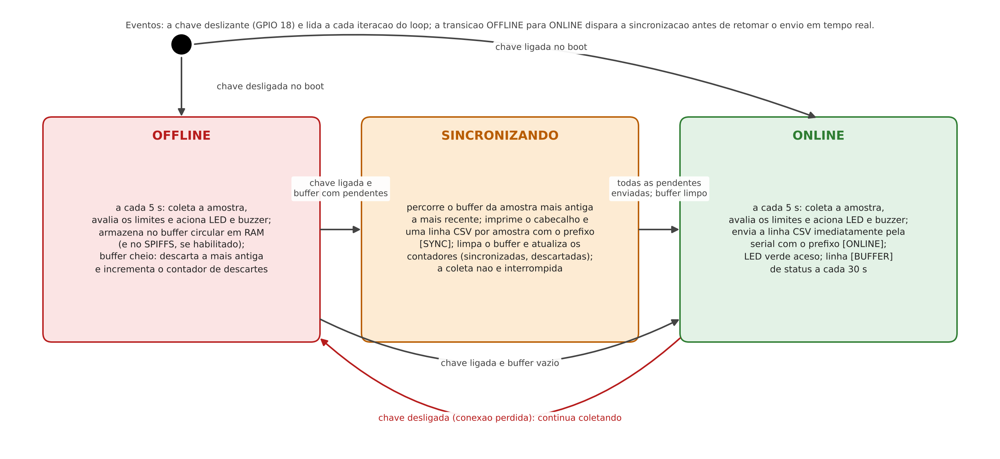
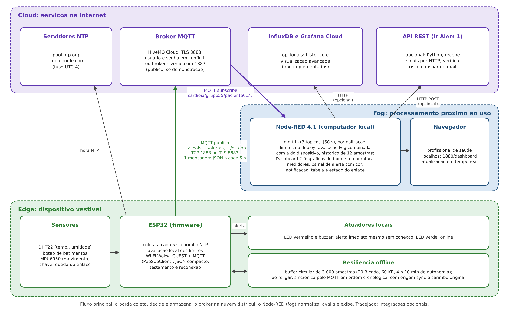
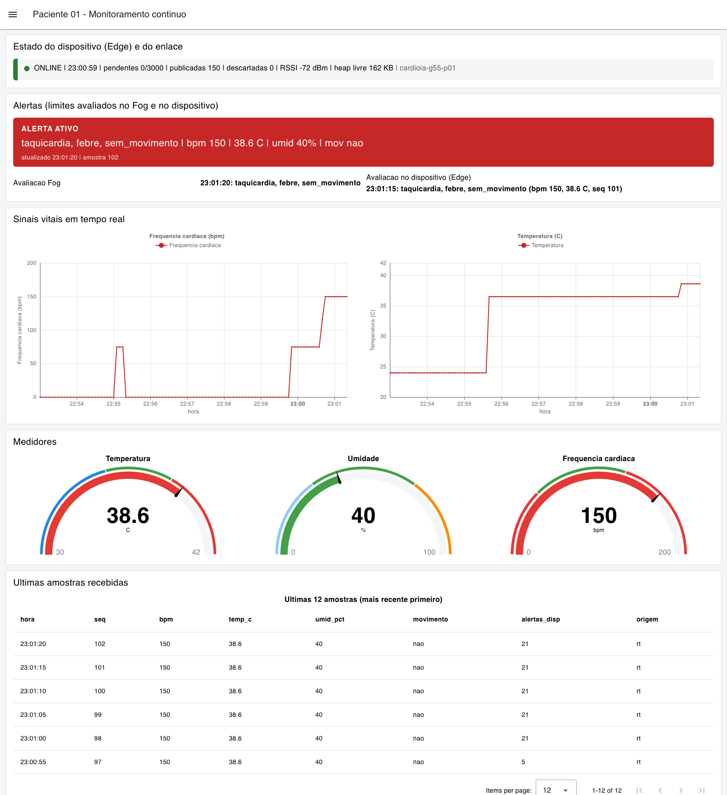

# FIAP - Faculdade de Informática e Administração Paulista

<p align="center">
<a href= "https://www.fiap.com.br/"></a>
</p>

<br>

# CardioIA: Monitoramento Contínuo, IoT no Peito do Paciente (Fase 3)

## Grupo 55

## 👨‍🎓 Integrantes:
- <a href="https://www.linkedin.com/in/silvio-guerreiro">Silvio Prestes Guerreiro Junior, RM567958</a>

## 👩‍🏫 Professores:
### Tutor(a)
- <a href="https://www.linkedin.com/in/leonardoorabona">Leonardo Ruiz Orabona</a>
### Coordenador(a)
- <a href="https://www.linkedin.com/company/inova-fusca">André Godoi Chiovato</a>

## 🔗 Links da entrega

| Entregável | Link |
|---|---|
| Projeto da Parte 1 no Wokwi (Edge: sensores, alertas locais e resiliência offline) | https://wokwi.com/projects/479362553804308481 |
| Projeto da Parte 2 no Wokwi (Fog/Cloud: MQTT) | https://wokwi.com/projects/479362979389911041 |
| Vídeo do Ir Além 2 (até 4 min, não listado) | https://youtu.be/PfXksf7mLBU |
| Relatório da Parte 1 (DOCX) | [`document/relatorio_parte1.docx`](document/relatorio_parte1.docx) |
| Relatório da Parte 2 (DOCX) | [`document/relatorio_parte2.docx`](document/relatorio_parte2.docx) |
| Fluxo do Node-RED (export completo) | [`src/parte2_fog_cloud/node_red/flows.json`](src/parte2_fog_cloud/node_red/flows.json) |
| Evidências (logs e capturas) | [`assets/evidencias/`](assets/evidencias/) |

## 📜 Descrição

O **CardioIA** é o projeto integrador do curso: uma plataforma digital que simula o ecossistema de uma cardiologia moderna apoiada por Inteligência Artificial, com dados clínicos, modelos de Machine Learning, Visão Computacional, IoT e agentes inteligentes para triagem, diagnóstico, monitoramento e previsão de eventos cardíacos. As doenças cardiovasculares são a principal causa de morte no mundo, com cerca de 17,9 milhões de óbitos anuais, e boa parte desses desfechos é evitável com detecção precoce.

Esta **Fase 3, "Monitoramento Contínuo: IoT no Peito do Paciente"**, constrói o primeiro dispositivo do ecossistema: um wearable cardíaco simulado no Wokwi com ESP32, que captura sinais vitais, decide e sinaliza alertas localmente, resiste à perda de conexão guardando as amostras e sincronizando-as depois, transmite tudo para a nuvem via MQTT e alimenta um dashboard em Node-RED com alertas automáticos. A fase integra os conceitos de Edge, Fog e Cloud Computing dos capítulos 8 e 9 do material do curso e a governança de dados de saúde do capítulo 7.

A entrega tem duas partes obrigatórias:

| Parte | O que foi construído | Técnica | Arquivos principais |
|---|---|---|---|
| 1. Armazenamento e processamento local (Edge) | Firmware para ESP32 com três sensores (DHT22, botão de batimentos, MPU6050), avaliação local de cinco regras de alerta com LED e buzzer, conectividade simulada por chave deslizante, buffer circular de 3.000 amostras em RAM com política de sobrescrita e contador de descartes, camada SPIFFS opcional por flag de compilação e sincronização em CSV pela serial ao voltar online | C++ (Arduino core para ESP32), interrupção para batimentos, média móvel, máquina de estados online/offline, struct empacotada de 16 bytes | [`src/parte1_edge/wokwi/`](src/parte1_edge/wokwi/) |
| 2. Transmissão para a nuvem e visualização (Fog/Cloud) | Evolução do firmware com Wi-Fi, NTP e MQTT (PubSubClient): três tópicos, JSON compacto, mensagens retidas, testamento, reconexão não bloqueante e sincronização do buffer pela nuvem; fluxo Node-RED com Dashboard 2.0 (gráficos de frequência cardíaca e temperatura no tempo real das amostras, medidores, painel de alerta com cor, notificação, tabela e estado do dispositivo) | MQTT 3.1.1, HiveMQ Cloud com TLS (perfil em `config.example.h`) ou broker público para demonstração, Node-RED 4.1 e @flowfuse/node-red-dashboard 1.34 | [`src/parte2_fog_cloud/esp32_mqtt/`](src/parte2_fog_cloud/esp32_mqtt/), [`src/parte2_fog_cloud/node_red/`](src/parte2_fog_cloud/node_red/) |

### Matriz de rastreabilidade (critérios de avaliação)

| Critério (2 pontos cada) | Onde está a evidência |
|---|---|
| Leitura de sensores | `sketch.ino` das duas partes: `lerDht`, `calcularBpm` (interrupção do botão, `isrBatimento`) e `lerMovimento` (MPU6050); log [`assets/evidencias/parte1/log_serial_parte1_wokwi_2026-10-30.txt`](assets/evidencias/parte1/log_serial_parte1_wokwi_2026-10-30.txt) com temperatura ajustada de 24,0 para 36,5 C, 80 e 150 bpm pelo botão e movimento pelo MPU6050 (`mov=sim`, módulo de 1,28 g); relatório da Parte 1, seções 2 e 6. O SPIFFS, não pontuado, está implementado sob a flag `USAR_SPIFFS` |
| Implementação de resiliência offline (Edge Computing) | `bufferArmazenar`, `sincronizarDaRam`, `atualizarEstadoConexao` e camada SPIFFS em `src/parte1_edge/wokwi/sketch.ino`; log com 41 amostras armazenadas offline, alertas locais durante a queda e `[SYNC] concluida: 41 enviadas, buffer limpo`; capturas `p1_02` a `p1_04`; dimensionamento numérico na seção 5 do relatório da Parte 1 (3.000 amostras, 48 KB, 4 h 10 min; cerca de 35 mil amostras em SPIFFS) |
| Envio via MQTT e integração com broker | `src/parte2_fog_cloud/esp32_mqtt/sketch.ino` (`conectarMqtt`, `publicar`, `sincronizarPendentes`, `atualizarRede`); log do monitor serial [`assets/evidencias/parte2/log_serial_parte2_wokwi_2026-10-30.txt`](assets/evidencias/parte2/log_serial_parte2_wokwi_2026-10-30.txt) e log do assinante independente [`assets/evidencias/parte2/log_broker_websocket_client_2026-10-30.txt`](assets/evidencias/parte2/log_broker_websocket_client_2026-10-30.txt) com mensagens retidas, testamento e nove amostras sincronizadas com origem `sync`; capturas `p2_01` a `p2_03`; relatório da Parte 2, seções 2 e 4 |
| Dashboard funcional e alertas automáticos | [`src/parte2_fog_cloud/node_red/flows.json`](src/parte2_fog_cloud/node_red/flows.json) (37 nós; funções `Normalizar amostra`, `Definir limites de alerta`, `Avaliar limites (Fog)`); capturas do dashboard em estado normal e com alerta, do editor e do painel de depuração em [`assets/evidencias/parte2/`](assets/evidencias/parte2/); limites e regras na seção 3 do relatório da Parte 2 |
| Documentação clara (código e relatórios) | Código comentado em português com cabeçalho, seção única de configuração e log por prefixos; [`document/relatorio_parte1.docx`](document/relatorio_parte1.docx) (fluxo de funcionamento e lógica de resiliência, com diagrama de blocos e máquina de estados) e [`document/relatorio_parte2.docx`](document/relatorio_parte2.docx) (arquitetura, fluxo MQTT, dashboard, evidências, segurança e boas práticas); este README; [`src/parte2_fog_cloud/node_red/README.md`](src/parte2_fog_cloud/node_red/README.md); [`src/ir_alem1_rest_email/README.md`](src/ir_alem1_rest_email/README.md) |

### Relação com as fases anteriores e seguintes

| Fase | Relação com esta entrega |
|---|---|
| Fase 1, Batimentos de Dados ([repositório](https://github.com/silvioguerreiro/FIAP_1TIAOS_2026_Ano2_Fase1)) | Curou as bases de dados cardiológicos e fixou os princípios de governança e LGPD que esta fase aplica aos dados gerados pelo dispositivo (minimização, pseudonimização, dados simulados) |
| Fase 2, Diagnóstico Automatizado ([repositório](https://github.com/silvioguerreiro/FIAP_2TIAOR_2026_Ano2_Fase2)) | Triagem por texto dos sintomas; esta fase acrescenta os sinais objetivos (frequência cardíaca, temperatura, movimento) que a triagem textual não tinha |
| Fase 6, Coração Sob Controle | A série temporal publicada em `.../sinais` (carimbo de tempo, sequência, sinais e rótulo de alerta por amostra) é o insumo para a previsão de crises com séries temporais |
| Fases 5 e 7 | Os alertas publicados em `.../alertas` podem alimentar o assistente virtual e a plataforma integrada |

Nenhum dado pessoal real é utilizado: todos os sinais são simulados no Wokwi e o paciente é um pseudônimo (`paciente01`, dispositivo `cardioia-g55-p01`).

## 🫀 Parte 1: Edge Computing (sensores, alertas locais e resiliência offline)

O circuito ([`diagram.json`](src/parte1_edge/wokwi/diagram.json)) reúne um ESP32 DevKit C V4, um DHT22 (GPIO 15), um botão que simula os batimentos (GPIO 4, cada pressão é um batimento; a frequência é a média móvel dos quatro últimos intervalos e zera após 5 s sem pressão), um MPU6050 (I2C) para movimento, uma chave deslizante que simula a conectividade Wi-Fi (GPIO 18), LEDs verde (online) e vermelho (alerta) e um buzzer.

A cada 5 s o firmware monta uma amostra de 16 bytes (carimbo de tempo, temperatura, umidade, bpm, movimento e máscara de alertas), avalia localmente os limites (bpm acima de 120 ou abaixo de 50; temperatura acima de 38,0 C ou abaixo de 35,0 C; ausência de movimento por mais de 10 min, ou 60 s no modo de demonstração) e aciona o LED vermelho e o buzzer antes de qualquer decisão de envio. Online, a amostra sai em CSV pela serial (a nuvem da Parte 1); offline, vai para um buffer circular de 3.000 posições em RAM (48 KB, 4 h 10 min de autonomia), com sobrescrita da amostra mais antiga e contador de descartes. Ao voltar online, as pendentes são enviadas em ordem cronológica com o prefixo `[SYNC]` e o buffer é limpo. A camada SPIFFS (`/pendentes.csv`, limite de 1 MB, cerca de 35 mil amostras) fica pronta para chip real sob a flag `USAR_SPIFFS`, já que no Wokwi o sistema de arquivos é volátil.

Trecho real do monitor serial (30/10/2026):

```
[OFFLINE] conexao perdida em t=33 s; armazenando localmente
[ALERTA] taquicardia (150 bpm > 120); (LED vermelho e buzzer acionados localmente)
[OFFLINE] 128,36.50,40.00,150,0,1 | armazenada (19/3000, mov=nao, |a|=1.00 g)
[BUFFER] pendentes=41/3000 armazenadas=41 sincronizadas=0 descartadas=0 batimentos=42 heap_livre=280652
[ONLINE] conexao restabelecida em t=241 s; 41 amostras pendentes
[SYNC] iniciando sincronizacao de 41 amostras pendentes (RAM)
[SYNC] ts_s,temp_c,umid_pct,bpm,mov,alertas
[SYNC] 38,24.00,40.00,0,0,8
[SYNC] concluida: 41 enviadas, buffer limpo (total sincronizadas=41, descartadas=0)
```

<p align="center"></p>

## ☁️ Parte 2: Fog/Cloud Computing (MQTT e dashboard)

O firmware da Parte 2 ([`sketch.ino`](src/parte2_fog_cloud/esp32_mqtt/sketch.ino)) conecta-se à rede `Wokwi-GUEST`, sincroniza o relógio por NTP e publica em três tópicos com JSON compacto:

| Tópico | Conteúdo | Retido |
|---|---|---|
| `cardioia/grupo55/paciente01/sinais` | Uma amostra a cada 5 s (`disp`, `seq`, `ts`, `tsrel`, `temp`, `umid`, `bpm`, `mov`, `alertas`, `origem` igual a `rt` ou `sync`) | Não |
| `cardioia/grupo55/paciente01/alertas` | Estado dos alertas avaliados no dispositivo (máscara e tipos por nome) | Sim |
| `cardioia/grupo55/paciente01/estado` | `online`, `offline`, `sincronizando` ou `offline_inesperado` (testamento), com pendentes, publicadas, heap e RSSI | Sim |

A chave deslizante simula a queda do enlace: o firmware publica `offline`, desliga o rádio, armazena localmente e, ao religar, reconecta e sincroniza as pendentes em ordem cronológica, removendo cada amostra do buffer só depois da publicação bem-sucedida. As credenciais ficam em `config.h` (fora do versionamento; modelo em [`config.example.h`](src/parte2_fog_cloud/esp32_mqtt/config.example.h)); sem o arquivo, como no projeto público do Wokwi, o firmware usa o broker público `broker.hivemq.com:1883`, sem TLS, apenas para demonstração.

O fluxo do Node-RED ([`flows.json`](src/parte2_fog_cloud/node_red/flows.json), 37 nós) assina os três tópicos, normaliza as amostras, define os limites no deploy, reavalia as regras na camada Fog combinando-as com a máscara do dispositivo e alimenta a página **Paciente 01 - Monitoramento continuo** do Dashboard 2.0: estado do dispositivo e do enlace, painel de alerta com cor e notificação, gráficos de frequência cardíaca e temperatura (eixo do tempo pelo carimbo da amostra, o que posiciona corretamente as amostras sincronizadas), medidores de temperatura, umidade e frequência cardíaca e tabela das últimas 12 amostras. Instalação e importação em [`src/parte2_fog_cloud/node_red/README.md`](src/parte2_fog_cloud/node_red/README.md).

<p align="center"></p>

<p align="center"></p>

## 🧪 Evidências e o que foi verificado

| Evidência | Arquivo | Como foi obtida |
|---|---|---|
| Log completo da Parte 1 | `assets/evidencias/parte1/log_serial_parte1_wokwi_2026-10-30.txt` | Monitor serial do Wokwi, 30/10/2026: boot, offline com 41 amostras, alertas de hipotermia, taquicardia e ausência de movimento, sincronização |
| Capturas da Parte 1 | `assets/evidencias/parte1/p1_01` a `p1_04` | Simulador com LEDs e monitor serial nos estados online, offline e sincronizado |
| Log serial da Parte 2 | `assets/evidencias/parte2/log_serial_parte2_wokwi_2026-10-30.txt` | Wokwi conectado ao broker público: Wi-Fi, NTP, MQTT, queda pela chave, 9 amostras sincronizadas |
| Log do lado do broker | `assets/evidencias/parte2/log_broker_websocket_client_2026-10-30.txt` | HiveMQ Websocket Client assinando `cardioia/grupo55/#`: mensagens retidas, testamento, amostras `rt` e `sync` |
| Capturas da Parte 2 | `assets/evidencias/parte2/p2_01` a `p2_03` | Cliente do broker e simulador em execução |
| Dashboard, editor e debug do Node-RED | `assets/evidencias/parte2/p2_10` a `p2_15` | Node-RED no computador do aluno recebendo o ESP32 do Wokwi pelo broker público (30/10/2026, 23h): dashboard normal, com alerta (taquicardia, febre e ausência de movimento), offline e após a sincronização de 15 amostras (`origem sync`), editor com o fluxo e painel de debug |
| Logs do Node-RED e do monitor serial dessa sessão | `assets/evidencias/parte2/log_node_red_mac_2026-10-30.txt`, `log_serial_parte2_wokwi_2026-10-30_nodered_mac.txt` | Conexão do Node-RED ao broker, duas quedas provocadas pela chave (14 e 15 amostras sincronizadas) e a limitação observada do simulador na reassociação Wi-Fi após 5 minutos com o rádio desligado |

Não verificado nesta entrega: o perfil HiveMQ Cloud com TLS e credenciais (pronto no código, não executado); a camada SPIFFS em chip real; a compilação fora do Wokwi. Essas lacunas estão declaradas nos relatórios.

## 🛡️ Segurança, LGPD e boas práticas

Dados de saúde são dados pessoais sensíveis (art. 5º, II, da Lei nº 13.709/2018). O protótipo aplica minimização (só os campos necessários trafegam), pseudonimização do paciente, credenciais fora do código versionado (`config.h` no `.gitignore`, credenciais do Node-RED no arquivo criptografado do próprio Node-RED), hierarquia de tópicos que permite controle de acesso por dispositivo no broker, perfil TLS com validação de certificado prevista para produção (`setCACert`), testamento e número de sequência para integridade e disponibilidade, e intervalo de amostragem e payload compacto para eficiência de rede e energia. O broker público usado na demonstração não oferece autenticação nem criptografia e não deve receber dados reais. A discussão completa está na seção 5 do relatório da Parte 2.

## 🧭 Limitações e próximos passos

- Os sinais são simulados: o botão como sensor de batimentos e o DHT22 como temperatura cutânea são substitutos didáticos de um sensor óptico de pulso e de um termistor de contato.
- A PubSubClient publica apenas com QoS 0; a confiabilidade dos alertas vem de mensagens retidas, sequência, testamento e remoção do buffer após publicação. A biblioteca arduino-mqtt (QoS 1 e 2) é a alternativa direta.
- Grafana Cloud e InfluxDB Cloud, opcionais, não foram implementados; o fluxo do Node-RED é o ponto natural de integração.
- No Wokwi, após cerca de 5 minutos com a chave desligada (rádio Wi-Fi desativado), o simulador não restabeleceu a associação à rede Wokwi-GUEST, mesmo com o vigia de associação do firmware repetindo `WiFi.begin` a cada 30 s (quatro tentativas registradas no log); o firmware seguiu coletando e armazenando (93 amostras) e a sincronização foi demonstrada com quedas de 65 s e 75 s. Em chip real a reassociação é feita pelo controlador Wi-Fi e, em último caso, por reinício supervisionado sem perda de dados com o SPIFFS ativo.
- Próximos passos no CardioIA: gravar o histórico em banco de séries temporais para a Fase 6, integrar os alertas ao assistente da Fase 5 e à plataforma da Fase 7, e evoluir o dispositivo para agrupar amostras e dormir entre leituras em um wearable a bateria.

## 🚀 Ir Além

| Atividade | Situação |
|---|---|
| Ir Além 1: comunicação automatizada com REST e e-mail | Concluído, na pasta [`src/ir_alem1_rest_email/`](src/ir_alem1_rest_email/) deste repositório: API REST em Python (FastAPI) que recebe e devolve sinais vitais (`POST /sinais`, `GET /sinais`, `GET /alertas`, `GET /pacientes/{disp}/resumo`, `GET /notificacoes`), módulo de risco com regras explícitas e testáveis (taquicardia, bradicardia, febre, hipotermia, ausência de movimento, dispositivo silencioso), automação de e-mail com modo simulado, SMTP local ou SMTP real e política anti-spam, cliente REST que simula o wearable, ponte MQTT que liga o ESP32 da Parte 2 à API, aba Node-RED de integração e 35 testes automatizados. Relatório em [`document/relatorio_ir_alem1.docx`](document/relatorio_ir_alem1.docx); evidências em [`assets/evidencias/ir_alem1/`](assets/evidencias/ir_alem1/); instruções em [`src/ir_alem1_rest_email/README.md`](src/ir_alem1_rest_email/README.md) |
| Ir Além 2: IA em séries temporais de saúde | Concluído, na pasta [`src/ir_alem2_ia_series/`](src/ir_alem2_ia_series/) deste repositório: notebook comentado e executado que compara a regra de limiares do firmware, uma regressão logística (scikit-learn) e uma rede neuromórfica simples (codificação por taxa e neurônios LIF em NumPy) na classificação de episódios de risco em janelas de 2 minutos de frequência cardíaca (1.200 episódios sintéticos documentados em cinco subtipos; aplicação às séries reais do protótipo). Métricas no teste: regra 0,897, regressão logística 1,000 e rede LIF 0,983 de acurácia, com discussão de interpretabilidade, custo computacional, latência de decisão e adequação à borda (capítulo 3 do curso). Relatório comparativo em [`document/relatorio_ir_alem2.docx`](document/relatorio_ir_alem2.docx); figuras em [`assets/figuras/ir_alem2/`](assets/figuras/ir_alem2/); instruções em [`src/ir_alem2_ia_series/README.md`](src/ir_alem2_ia_series/README.md); vídeo com os resultados e legendas explicativas: https://youtu.be/PfXksf7mLBU |

Critérios do Ir Além 1 e onde está a evidência:

| Critério | Evidência |
|---|---|
| Implementação correta do consumo de API REST | `cliente/cliente_rest.py` (POST e GET com `requests`), `cliente/ponte_mqtt_api.py`, aba Node-RED com `http request`; saída em `assets/evidencias/ir_alem1/saida_cliente_rest_2026-10-31.txt` (151 amostras enviadas e consultadas) |
| Lógica de verificação de riscos bem definida | `api/risco.py` (uma função pura por regra, limites no `.env`, combinação com a máscara do dispositivo); `tests/test_risco.py` com os limites nas fronteiras |
| Automação do envio de e-mail funcional | `api/notificacao.py` (modos simulado, local e smtp, anti-spam de 10 min); `assets/evidencias/ir_alem1/emails_simulados_cliente_rest_2026-10-31.log` com os três e-mails gerados; `tests/test_notificacao.py` |
| Clareza do código e documentação | Docstrings e comentários em português, README do módulo, `relatorio_ir_alem1.docx`, documentação OpenAPI em `/docs` |
| Organização da entrega | Pacotes `api/`, `cliente/`, `tests/`, `node_red/`; `requirements.txt`; `.env.example`; `.gitignore`; 35 testes aprovados (`assets/evidencias/ir_alem1/testes_pytest_2026-10-31.txt`) |

Critérios do Ir Além 2 e onde está a evidência:

| Critério | Evidência |
|---|---|
| Implementação funcional dos modelos | Notebook `src/ir_alem2_ia_series/cardioia_fase3_ir_alem2_series_lif.ipynb`, seções 5 (regressão logística com validação cruzada) e 6 (classe `RedeLIF`: codificação por campos receptivos, neurônios LIF, regra delta de taxa), com saídas gravadas |
| Comparação clara entre os métodos | Seção 7 do notebook: tabela de métricas, matrizes de confusão (`assets/figuras/ir_alem2/matrizes_confusao.png`), acerto por subtipo, custo por janela e latência de decisão; seções 3 e 4 do relatório |
| Clareza e organização do notebook | Nove seções numeradas com texto explicativo antes de cada bloco de código, sementes fixas, gerador de dados documentado, execução em menos de um minuto; README do módulo e `requirements.txt` |
| Qualidade do relatório comparativo | `document/relatorio_ir_alem2.docx` (duas páginas): dados, modelos, resultados, discussão de vantagens e limitações e conclusão com recomendação para o CardioIA |
| Demonstração em vídeo com análise crítica | https://youtu.be/PfXksf7mLBU (3 min 02 s, legendas explicativas): dados, modelos, comparação, custo em CPU versus hardware neuromórfico, limitações e aplicação à série do protótipo |

## 📁 Estrutura de pastas

Dentre os arquivos e pastas presentes na raiz do projeto, definem-se:

- <b>.github</b>: arquivos de configuração específicos do GitHub (modelo de relato de problemas do repositório).

- <b>assets</b>: elementos não estruturados do repositório: logo institucional, figuras dos relatórios (diagrama de blocos, máquina de estados, arquitetura e sequência MQTT), figuras do notebook do Ir Além 2 e as evidências de execução (logs e capturas) das Partes 1 e 2.

- <b>config</b>: arquivos de configuração do projeto: dependências Python das figuras (`requirements.txt`) e pacotes Node.js do simulador de mensagens, do broker local de teste e das capturas (`package.json`).

- <b>document</b>: documentos do projeto: relatórios das Partes 1 e 2 e dos Ir Além 1 e 2 em DOCX, documento de entrega, checklist da rubrica, roteiro de entrega e os rascunhos em Markdown que geram os relatórios (`document/md/`).

- <b>scripts</b>: scripts auxiliares: gerador do `flows.json`, simulador MQTT com o formato do firmware, gerador do fluxo de integração com a API, gerador das figuras, extrator das séries do protótipo para o Ir Além 2, capturas do editor Node-RED por Playwright e conversor dos relatórios de Markdown para DOCX.

- <b>src</b>: todo o código-fonte do projeto: firmware da Parte 1 (`src/parte1_edge/wokwi/`), firmware MQTT da Parte 2 (`src/parte2_fog_cloud/esp32_mqtt/`), fluxo do Node-RED (`src/parte2_fog_cloud/node_red/`) API REST com e-mail do Ir Além 1 (`src/ir_alem1_rest_email/`) e notebook do Ir Além 2 (`src/ir_alem2_ia_series/`).

- <b>README.md</b>: arquivo que serve como guia e explicação geral sobre o projeto (o mesmo que você está lendo agora).

```
FIAP_2TIAOR_2026_Ano2_Fase3/
├── .github/
│   └── problem-report.md                  # modelo de relato de problemas (modelo FIAP)
├── .gitattributes                         # normalização de fim de linha
├── .gitignore                             # config.h com credenciais, caches e arquivos de sistema
├── LICENSE                                # licença MIT
├── README.md                              # este documento
├── assets/
│   ├── logo-fiap.png                      # logo institucional
│   ├── figuras/                           # diagramas dos relatórios (PNG)
│   │   └── ir_alem2/                      # figuras geradas pelo notebook do Ir Além 2
│   └── evidencias/
│       ├── parte1/                        # log serial e capturas do Wokwi (Parte 1)
│       ├── parte2/                        # logs serial e do broker, capturas do Wokwi e do Node-RED (Parte 2)
│       └── ir_alem1/                      # saídas do cliente, da ponte MQTT, e-mails simulados, testes e captura do Node-RED
├── config/
│   ├── requirements.txt                   # matplotlib (figuras)
│   └── package.json                       # mqtt e aedes (simulador e broker local de teste)
├── document/
│   ├── relatorio_parte1.docx              # relatório da Parte 1 (Edge)
│   ├── relatorio_parte2.docx              # relatório da Parte 2 (Fog/Cloud)
│   ├── relatorio_ir_alem1.docx            # relatório do Ir Além 1 (REST e e-mail)
│   ├── relatorio_ir_alem2.docx            # relatório comparativo do Ir Além 2 (séries temporais)
│   ├── documento_entrega.docx             # capa, links, resumo e declaração LGPD
│   ├── checklist_rubrica.md               # auditoria contra os critérios de avaliação
│   ├── roteiro_entrega.md                 # publicação do repositório e arquivo de upload
│   └── md/                                # rascunhos em Markdown dos relatórios
├── scripts/
│   ├── gerar_flows_node_red.py            # gera src/parte2_fog_cloud/node_red/flows.json
│   ├── simulador_mqtt_esp32.js            # publica mensagens no formato do firmware (testes)
│   ├── gerar_flow_integracao_api.py       # gera a aba Node-RED de integração com a API (Ir Além 1)
│   ├── captura_integracao_api_playwright.js # captura do editor Node-RED usada nas evidências (Ir Além 1)
│   ├── captura_editor_node_red_mac.js     # captura do editor e do debug no computador do aluno (playwright-core)
│   ├── desenhar_figuras_relatorios.py     # figuras dos relatórios (matplotlib)
│   ├── extrair_series_prototipo.py        # extrai as séries reais do protótipo dos logs (Ir Além 2)
│   ├── fig_p2_sequencia_mqtt.mmd          # fonte Mermaid do diagrama de sequência
│   └── md_para_docx.js                    # converte os rascunhos Markdown em DOCX
└── src/
    ├── parte1_edge/
    │   └── wokwi/
    │       ├── sketch.ino                 # firmware da Parte 1 (Edge)
    │       ├── diagram.json               # circuito do Wokwi
    │       ├── libraries.txt              # DHT sensor library, Adafruit Unified Sensor, Adafruit MPU6050, Adafruit BusIO
    │       ├── wokwi.toml                 # Wokwi para VS Code
    │       └── platformio.ini             # PlatformIO (alternativa ao Arduino IDE)
    ├── parte2_fog_cloud/
    │   ├── esp32_mqtt/
    │   │   ├── sketch.ino                 # firmware da Parte 2 (Wi-Fi, NTP, MQTT)
    │   │   ├── config.example.h           # modelo de configuração (HiveMQ Cloud com TLS)
    │   │   ├── config.broker_publico.h    # perfil do broker público (demonstração)
    │   │   ├── .gitignore                 # exclui config.h
    │   │   └── diagram.json, libraries.txt, wokwi.toml, platformio.ini
    │   └── node_red/
    │       ├── flows.json                 # export completo do fluxo e do dashboard
    │       ├── pacotes.txt                # versões dos pacotes usados
    │       └── README.md                  # instalação, importação e teste
    ├── ir_alem1_rest_email/
    │   ├── api/                           # FastAPI: main, modelos, risco, notificacao, armazenamento, config
    │   ├── cliente/                       # cliente_rest.py (simula o wearable) e ponte_mqtt_api.py (MQTT -> API)
    │   ├── node_red/flows_integracao_api.json  # aba Node-RED: mqtt in -> http request POST /sinais
    │   ├── tests/                         # 35 testes (risco, e-mail, API)
    │   ├── requirements.txt, .env.example, .gitignore
    │   └── README.md                      # fluxo, regras, execução e integração
    └── ir_alem2_ia_series/
        ├── cardioia_fase3_ir_alem2_series_lif.ipynb  # notebook comparativo (regra, regressão logística, rede LIF)
        ├── dados/                         # séries reais do protótipo (CSV extraído dos logs)
        ├── requirements.txt
        └── README.md                      # o que o notebook faz, resultados e execução
```

## 🔧 Como executar o código

**Parte 1 e Parte 2 no Wokwi (web):** abra os links da seção "Links da entrega" e clique em iniciar. Para recriar do zero: em https://wokwi.com/projects/new/esp32, cole `sketch.ino` e `diagram.json` da pasta desejada e adicione as bibliotecas de `libraries.txt` no Library Manager (a Parte 2 acrescenta `PubSubClient`). Durante a simulação: clique na chave para alternar online e offline, clique no DHT22 para ajustar a temperatura (36,5 C é a temperatura cutânea normal; o padrão de 24 C dispara hipotermia), pressione o botão repetidamente para gerar batimentos e mova um eixo do MPU6050 para registrar movimento.

**Parte 2 com HiveMQ Cloud (local, VS Code com Wokwi ou Arduino IDE):** copie `config.example.h` para `config.h`, preencha o endereço do cluster, o usuário e a senha, e compile. O arquivo `config.h` não é versionado.

**Node-RED (Dashboard 2.0):**

```bash
npm install -g --unsafe-perm node-red
cd ~/.node-red && npm install @flowfuse/node-red-dashboard
node-red
```

Importe `src/parte2_fog_cloud/node_red/flows.json` pelo menu Import, confira o broker no nó de configuração (broker público por padrão; para o HiveMQ Cloud, altere servidor e porta, marque TLS e preencha usuário e senha na aba Security), clique em Deploy e abra http://localhost:1880/dashboard/paciente01.

**Teste sem o ESP32:** `npm install mqtt` e `node scripts/simulador_mqtt_esp32.js mqtt://broker.hivemq.com:1883` publica mensagens no formato do firmware, incluindo cenários de taquicardia e febre.

**Ir Além 1 (API REST e e-mail):** `cd src/ir_alem1_rest_email && pip install -r requirements.txt && uvicorn api.main:app` e, em outro terminal, `python -m cliente.cliente_rest`; testes com `python -m pytest -v`. Detalhes, integração MQTT e modos de e-mail no README do módulo.

**Ir Além 2 (séries temporais):** `cd src/ir_alem2_ia_series && pip install -r requirements.txt && jupyter lab cardioia_fase3_ir_alem2_series_lif.ipynb` (ou abra o notebook no VS Code); as saídas já estão gravadas e a execução completa leva menos de um minuto. Detalhes e resultados no README do módulo.

**Regenerar artefatos:** `python3 scripts/gerar_flows_node_red.py src/parte2_fog_cloud/node_red/flows.json` (sem dependências); `pip install -r config/requirements.txt && python3 scripts/desenhar_figuras_relatorios.py` (figuras); `node scripts/md_para_docx.js document/md/relatorio_parte1.md document/relatorio_parte1.docx "CardioIA, Fase 3, Parte 1"` (relatórios; requer o pacote npm `docx`).

## 🗃 Histórico de lançamentos

* 0.1.0 - 02/11/2026
    * Entrega da Fase 3: firmware da Parte 1 (Edge) e da Parte 2 (MQTT), fluxo do Node-RED com Dashboard 2.0, Ir Além 1 (API REST, risco e e-mail), Ir Além 2 (notebook comparativo entre regressão logística e rede LIF, relatório e vídeo), evidências, relatórios, documento de entrega e documentação.

## 📚 Referências (ABNT NBR 6023)

- BRASIL. **Lei nº 13.709, de 14 de agosto de 2018**. Lei Geral de Proteção de Dados Pessoais (LGPD). Diário Oficial da União: seção 1, Brasília, DF, 15 ago. 2018.
- ESPRESSIF SYSTEMS. **ESP32 Series Datasheet**. Shanghai: Espressif, 2025. Disponível em: https://www.espressif.com/sites/default/files/documentation/esp32_datasheet_en.pdf. Acesso em: 30 out. 2026.
- FIAP. **CardioIA Conectada: IoT e Visualização de Dados para a Saúde Digital**. Capítulo 1 do material didático da Fase 3, 2º ano, curso de Inteligência Artificial. São Paulo: FIAP, 2025.
- FIAP. **Governança Inteligente: Frameworks e Arquiteturas de Dados na Era da IA**. Capítulo 7 do material didático da Fase 3, 2º ano, curso de Inteligência Artificial. São Paulo: FIAP, 2025.
- FIAP. **Cloud Computing como Pilar da IoT Moderna**. Capítulo 8 do material didático da Fase 3, 2º ano, curso de Inteligência Artificial. São Paulo: FIAP, 2025.
- FIAP. **Inteligência na Borda: Fog e Edge Computing Transformando a IoT**. Capítulo 9 do material didático da Fase 3, 2º ano, curso de Inteligência Artificial. São Paulo: FIAP, 2025.
- FLOWFUSE. **Node-RED Dashboard 2.0 documentation**. Disponível em: https://dashboard.flowfuse.com/. Acesso em: 30 out. 2026.
- GUERREIRO JUNIOR, S. P. **CardioIA, Fase 1: Batimentos de Dados** [repositório]. GitHub, 2026. Disponível em: https://github.com/silvioguerreiro/FIAP_1TIAOS_2026_Ano2_Fase1. Acesso em: 30 out. 2026.
- GUERREIRO JUNIOR, S. P. **CardioIA, Fase 2: Diagnóstico Automatizado** [repositório]. GitHub, 2026. Disponível em: https://github.com/silvioguerreiro/FIAP_2TIAOR_2026_Ano2_Fase2. Acesso em: 30 out. 2026.
- HIVEMQ. **HiveMQ Cloud documentation**. Disponível em: https://docs.hivemq.com/hivemq-cloud/. Acesso em: 30 out. 2026.
- OASIS. **MQTT Version 3.1.1**. OASIS Standard, 2014. Disponível em: http://docs.oasis-open.org/mqtt/mqtt/v3.1.1/os/mqtt-v3.1.1-os.html. Acesso em: 30 out. 2026.
- O'LEARY, N. **Arduino Client for MQTT (PubSubClient)**. Disponível em: https://pubsubclient.knolleary.net/. Acesso em: 30 out. 2026.
- OPENJS FOUNDATION. **Node-RED documentation**. Disponível em: https://nodered.org/docs/. Acesso em: 30 out. 2026.
- WOKWI. **Wokwi Documentation**. Disponível em: https://docs.wokwi.com/. Acesso em: 30 out. 2026.

## 📋 Licença

O código, a documentação e os dados simulados deste repositório estão sob a licença MIT (arquivo [`LICENSE`](LICENSE)).

<p xmlns:cc="http://creativecommons.org/ns#" xmlns:dct="http://purl.org/dc/terms/"><a property="dct:title" rel="cc:attributionURL" href="https://github.com/agodoi/template">MODELO GIT FIAP</a> por <a rel="cc:attributionURL dct:creator" property="cc:attributionName" href="https://fiap.com.br">Fiap</a> está licenciado sobre <a href="http://creativecommons.org/licenses/by/4.0/?ref=chooser-v1" target="_blank" rel="license noopener noreferrer" style="display:inline-block;">Attribution 4.0 International</a>.</p>

## ⚠️ Aviso

Projeto acadêmico desenvolvido na FIAP com sinais simulados. Nenhum artefato deste repositório é dispositivo médico nem ferramenta de monitoramento clínico real, e nenhum alerta gerado substitui a avaliação de um profissional de saúde.
