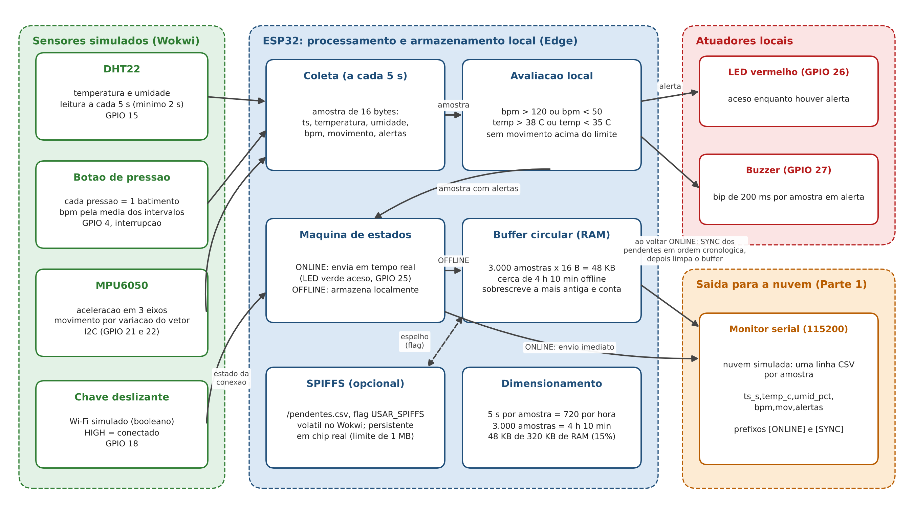
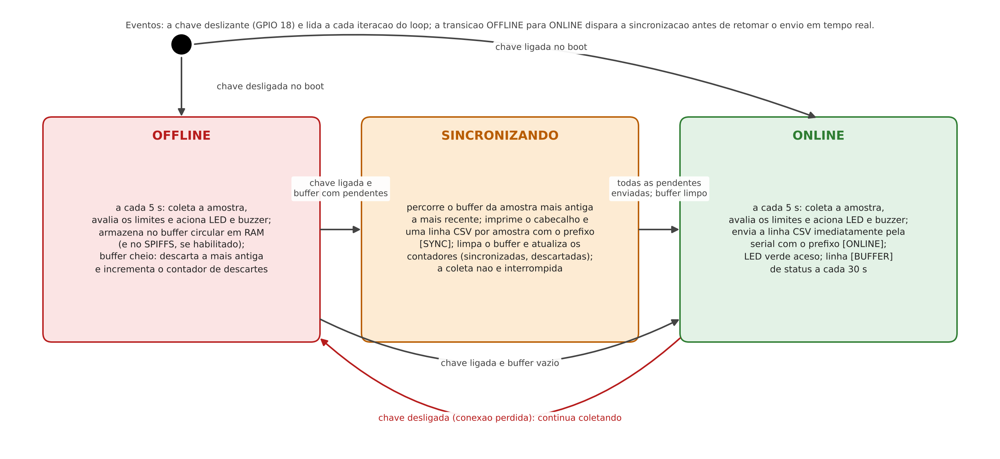
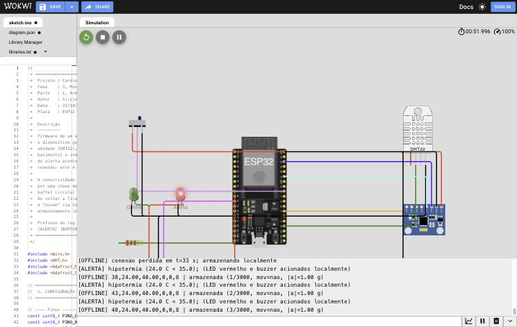
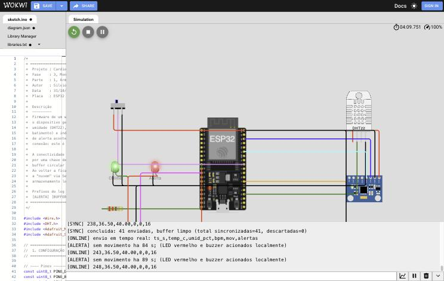

# CardioIA, Fase 3: Monitoramento Contínuo. Relatório da Parte 1: armazenamento e processamento local (Edge Computing)


| Campo | Valor |
|---|---|
| Projeto | CardioIA, Ano 2, Fase 3 (Monitoramento Contínuo: IoT no Peito do Paciente) |
| Parte | 1, Armazenamento e processamento local (Edge Computing) |
| Aluno | Silvio Prestes Guerreiro Junior, RM 567958 |
| Turma e grupo | 2TIAOR, Grupo 55 (formato individual) |
| Curso | Inteligência Artificial, FIAP |
| Tutor | Leonardo Ruiz Orabona |
| Coordenador | André Godoi Chiovato |
| Data | 31 de outubro de 2026 |
| Repositório | https://github.com/silvioguerreiro/FIAP_2TIAOR_2026_Ano2_Fase3 |
| Projeto no Wokwi | https://wokwi.com/projects/479362553804308481 |

## 1. Objetivo e contexto no CardioIA

A Fase 3 do CardioIA leva o projeto para fora da base de dados e do modelo: pela primeira vez o paciente é observado continuamente por um dispositivo. O enunciado pede um protótipo funcional de wearable cardíaco simulado no Wokwi, com ESP32, que capture sinais vitais, armazene e processe as leituras localmente, garanta resiliência quando a conexão falhar e, na Parte 2, transmita os dados para a nuvem via MQTT e os exiba em um dashboard com alertas. Este relatório cobre a Parte 1: a camada de borda (Edge), responsável por coletar, decidir e guardar.

A Fase 1 do CardioIA entregou a curadoria de bases cardiológicas; a Fase 2, a triagem de sintomas por texto. O que faltava era a fonte de sinais objetivos ao longo do tempo. O dispositivo descrito aqui produz exatamente isso: uma série temporal de frequência cardíaca, temperatura, umidade e movimento, com carimbo de tempo e avaliação de risco feita no próprio aparelho. Essa série é o insumo da Fase 6 (Coração Sob Controle), que trabalhará com previsão de crises a partir de séries temporais, e alimenta o dashboard da Parte 2 desta fase.

O material do curso enquadra a escolha arquitetural. O capítulo 9 (Inteligência na Borda) define Edge Computing como o processamento realizado diretamente no dispositivo onde os dados são gerados, sem depender de servidores locais ou em nuvem para a tomada de decisão, e aponta dispositivos médicos portáteis entre as aplicações em que a borda é praticamente mandatória por causa da latência e da operação autônoma sem rede. O capítulo 8 (Cloud Computing como Pilar da IoT Moderna) descreve os wearables de saúde como exemplos clássicos de borda, por medirem sinais vitais continuamente e emitirem alertas ao usuário em caso de risco. O capítulo 1 da fase resume a motivação em uma frase: quando a latência pode custar uma vida, processar dados localmente é essencial. O projeto da Parte 1 foi construído em torno dessa tese.

## 2. Hardware simulado e sensores

O circuito foi montado no Wokwi (wokwi.com) com uma placa ESP32 DevKit C V4 e os componentes da Tabela 1. O enunciado exige no mínimo dois sensores distintos, sendo um deles o DHT22; o projeto usa três, todos coerentes com o modelo de negócio de um wearable cardíaco.

Tabela 1. Componentes do diagrama (diagram.json) e pinos do ESP32.

| Componente | Função no wearable | Pino | Observação |
|---|---|---|---|
| DHT22 | Temperatura (cutânea, no modelo de negócio) e umidade | GPIO 15 | Sensor obrigatório; intervalo mínimo de leitura de 2 s respeitado pela amostragem de 5 s |
| Botão de pressão | Simula o sensor de batimentos: cada pressão é um batimento | GPIO 4, INPUT_PULLUP, interrupção na borda de descida | Frequência cardíaca calculada pela média móvel dos últimos 4 intervalos entre pressões; zera após 5 s sem pressão; debounce de 150 ms |
| MPU6050 | Acelerômetro para detecção de movimento e de ausência de movimento | I2C, SDA GPIO 21 e SCL GPIO 22 | Faixa de 4 g e filtro de 21 Hz; movimento quando o vetor de aceleração varia mais de 0,10 g entre leituras ou se afasta mais de 0,30 g de 1 g |
| Chave deslizante | Simula a conectividade Wi-Fi (variável booleana exigida pelo enunciado) | GPIO 18, INPUT_PULLDOWN | Posição ligada = conectado |
| LED verde | Indica estado online | GPIO 25 | Atuador de estado |
| LED vermelho | Indica alerta local ativo | GPIO 26 | Atuador de alerta |
| Buzzer | Aviso sonoro de alerta | GPIO 27 | Bip de 200 ms a cada amostra em alerta |

O botão como fonte de batimentos é a opção sugerida pelo próprio enunciado da Parte 2 ("um botão de pressão, que você aperta x vezes por minuto") e tem uma vantagem didática: permite reproduzir qualquer frequência cardíaca, inclusive taquicardia, pressionando o botão em ritmo conhecido. O MPU6050 é o sensor usado nos capítulos 8 e 9 do curso; aqui ele responde pelo indicador de movimento, que em um paciente cardíaco monitorado tem valor clínico próprio: uma pessoa que para de se mover por muito tempo pode ter sofrido uma queda ou uma síncope. A detecção foi implementada pela variação do vetor de aceleração entre leituras, em vez da interrupção por hardware do pino INT descrita no capítulo 9, porque no simulador os eixos do MPU6050 são alterados por controles deslizantes e a comparação entre leituras é mais robusta para demonstrar o conceito; a alternativa por interrupção fica registrada como evolução natural em chip real.

## 3. Fluxo de funcionamento

A Figura 1 apresenta o diagrama de blocos do firmware (sketch.ino, cerca de 560 linhas em C++ comentado em português). A cada 5 segundos a função coletarAmostra monta uma estrutura Amostra de 16 bytes com o carimbo de tempo em segundos desde o boot, temperatura, umidade, frequência cardíaca, indicador de movimento e uma máscara de bits com os alertas. A avaliação dos limites de alerta acontece imediatamente, no dispositivo, e aciona o LED vermelho e o buzzer antes de qualquer decisão sobre envio. Só depois a máquina de estados decide o destino da amostra: impressão imediata em CSV no monitor serial, que faz o papel da nuvem nesta parte, ou armazenamento local.



Figura 1. Diagrama de blocos do dispositivo da Parte 1: sensores, processamento local, armazenamento e saídas.

Os limites de alerta avaliados localmente são: frequência cardíaca acima de 120 bpm (taquicardia) ou abaixo de 50 bpm quando há batimentos registrados (bradicardia); temperatura acima de 38,0 C (febre) ou abaixo de 35,0 C (hipotermia); e ausência de movimento por mais de 10 minutos em produção, reduzida para 60 segundos no modo de demonstração (MODO_DEMONSTRACAO 1) para que o alerta possa ser observado em uma sessão curta de simulação. Os valores de frequência cardíaca e de febre são os sugeridos pelo enunciado; os demais seguem faixas clínicas usuais e são justificados em detalhe no relatório da Parte 2, onde também são aplicados na camada Fog. A regra de ausência de movimento só é avaliada depois que o sensor registrou movimento pelo menos uma vez, para evitar um falso alerta nos primeiros segundos após o boot.

A Figura 2 mostra a máquina de estados que governa a conectividade simulada. A chave deslizante é lida a cada iteração do loop. Em OFFLINE, as amostras são armazenadas; na transição para ONLINE, o firmware entra em um estado transitório de sincronização, envia todas as amostras pendentes em ordem cronológica, da mais antiga à mais recente, com o prefixo [SYNC], limpa o armazenamento e só então retoma o envio em tempo real. A coleta nunca é interrompida: a temporização usa millis() e o loop permanece leve, de modo que a sincronização de um buffer grande não atrasa a próxima amostra de forma perceptível.



Figura 2. Máquina de estados online e offline do firmware, com o estado transitório de sincronização.

O log serial é estruturado por prefixos ([BOOT], [SENSOR], [ONLINE], [OFFLINE], [SYNC], [ALERTA], [BUFFER], [SPIFFS]), o que facilita a leitura pelo avaliador e, na prática de engenharia, permite filtrar o log por estado. Uma linha [BUFFER] a cada 30 segundos informa pendentes, armazenadas, sincronizadas, descartadas, batimentos contados e heap livre, o que serviu para medir o consumo de memória relatado na seção 5.

## 4. Lógica de resiliência offline

A resiliência foi implementada em duas camadas, com o mesmo formato de registro. A primeira é um buffer circular em RAM com capacidade para 3.000 amostras, alocado estaticamente (o tamanho é conhecido em tempo de compilação e um static_assert garante que a estrutura ocupe exatamente 16 bytes). Quando o buffer enche, a política é sobrescrever a amostra mais antiga e incrementar um contador de descartes, que aparece no log e na sincronização. Essa escolha é deliberada para um monitor de saúde: a amostra mais recente é a que tem valor para a decisão clínica, e o contador preserva a informação de que houve perda, em vez de escondê-la.

A segunda camada é a gravação em arquivo CSV no SPIFFS (/pendentes.csv), ativada pela flag de compilação USAR_SPIFFS. O enunciado observa, corretamente, que o SPIFFS só é persistente em um ESP32 físico: nos simuladores Wokwi (web ou VS Code) o sistema de arquivos existe apenas durante a sessão e é perdido ao encerrar a simulação, razão pela qual o item não é pontuado. O código foi escrito pronto para chip real: monta o sistema de arquivos (formatando na primeira vez), informa se há um arquivo pendente de uma execução anterior, grava uma linha por amostra, limita o arquivo a 1 MB e, ao voltar online, lê o arquivo linha a linha, envia pela serial e o remove, cumprindo literalmente a instrução de enviar os dados armazenados e apagar o arquivo local. Quando o SPIFFS está habilitado, o arquivo é a fonte de verdade na sincronização e o buffer em RAM é limpo em seguida; quando não está, a sincronização lê o buffer em RAM. A entrega padrão usa USAR_SPIFFS 0, porque no Wokwi o resultado observável é idêntico e o buffer em RAM funciona em qualquer simulador; a flag e as funções spiffsIniciar, spiffsGravar e sincronizarDoSpiffs estão no código entregue.

O comportamento essencial para a pontuação de resiliência é demonstrado pelo log da seção 6: com a chave desligada o dispositivo continuou coletando a cada 5 s, avaliando e sinalizando alertas localmente e armazenando 41 amostras; quando a chave foi religada, as 41 amostras foram enviadas em ordem cronológica e o buffer foi limpo, sem perda e sem interrupção da coleta.

## 5. Dimensionamento do armazenamento

O enunciado pede que a estratégia de armazenamento limitado seja alinhada ao modelo de negócio e pergunta quantos milhares de amostras o dispositivo registra até voltar a ficar online. O modelo de negócio adotado é o de um paciente cardíaco monitorado em casa ou em deslocamento, com conexão Wi-Fi doméstica ou celular sujeita a quedas de minutos a algumas horas. O dimensionamento parte do intervalo de amostragem e chega ao tempo de autonomia, confrontado com a memória disponível (Tabela 2).

Tabela 2. Dimensionamento do armazenamento offline.

| Grandeza | Valor | Origem |
|---|---|---|
| Intervalo de amostragem | 5 s (720 amostras por hora, 17.280 por dia) | Respeita os 2 s mínimos do DHT22 e acompanha variações de frequência cardíaca com resolução suficiente para alertas |
| Tamanho da amostra em RAM | 16 bytes (Parte 1) e 20 bytes (Parte 2, com número de sequência) | struct empacotada, verificada por static_assert |
| Capacidade do buffer | 3.000 amostras | Constante CAPACIDADE_BUFFER |
| Memória ocupada pelo buffer | 48.000 bytes (Parte 1) e 60.000 bytes (Parte 2) | Impresso no boot: buffer=3000 amostras x 16 bytes = 48000 bytes |
| Autonomia offline | 15.000 s, ou 4 h 10 min | 3.000 x 5 s |
| Heap livre medido no Wokwi com o buffer alocado | 283.376 bytes no boot e 280.652 bytes com os sensores em operação (Parte 1); 220.420 bytes no boot e cerca de 160.000 bytes com Wi-Fi e MQTT ativos (Parte 2) | Linhas [BOOT] e [BUFFER] dos logs |
| Linha CSV no SPIFFS | cerca de 30 bytes por amostra (exemplo: 1793409205,36.50,40.00,80,1,0) | formatarCsv |
| Capacidade do arquivo de 1 MB | cerca de 34.900 amostras, ou 48 h | 1.048.576 / 30 bytes x 5 s |
| Partição SPIFFS padrão em chip real | cerca de 1,4 MB (0x160000 bytes) na tabela de partições padrão do Arduino-ESP32 para flash de 4 MB | Documentação do Arduino-ESP32 |

A resposta direta à pergunta do enunciado é: o dispositivo registra 3 mil amostras em RAM, o equivalente a 4 horas e 10 minutos sem conexão, antes de começar a sobrescrever as mais antigas; em um chip real com a camada SPIFFS habilitada, o arquivo de 1 MB acomoda cerca de 35 mil amostras, ou dois dias de coleta. Os 4 h 10 min cobrem a maioria das quedas de rede doméstica e um deslocamento típico do paciente fora do alcance do Wi-Fi, e o custo de 48 KB corresponde a cerca de 15% da memória dinâmica que o ESP32 disponibiliza à aplicação (aproximadamente 320 KB dos 520 KB de SRAM do chip). Haveria espaço para um buffer maior, mas a Parte 2 precisa de memória para as pilhas Wi-Fi, TLS e MQTT (o heap livre com tudo ativo ficou em torno de 160 KB), e dobrar a capacidade traria pouca vantagem prática frente à camada persistente em flash. O limite de 1 MB para o arquivo deixa folga na partição de 1,4 MB para o desgaste da flash e para outros usos.

## 6. Evidências de execução

O projeto foi compilado e executado no Wokwi em 30 de outubro de 2026. O log completo está em assets/evidencias/parte1/log_serial_parte1_wokwi_2026-10-30.txt, acompanhado das capturas p1_01 a p1_04. O trecho a seguir, sem edição de conteúdo, mostra o boot, a perda da conexão, o armazenamento com alertas locais e a sincronização.

```
[BOOT] CardioIA Fase 3, Parte 1 (Edge): wearable cardiaco simulado
[BOOT] amostragem=5000 ms, buffer=3000 amostras x 16 bytes = 48000 bytes
[BOOT] autonomia offline estimada=15000 s (4.2 h)
[BOOT] limites: bpm>120 taquicardia, bpm<50 bradicardia, temp>38.0 febre, temp<35.0 hipotermia, sem movimento>60 s
[BOOT] heap livre antes dos sensores=283376 bytes
[SENSOR] MPU6050 iniciado (acelerometro, faixa 4 g)
[SPIFFS] desativado por compilacao (USAR_SPIFFS 0); resiliencia via buffer em RAM
[ONLINE] estado inicial definido pela chave Wi-Fi simulada
[ONLINE] 33,24.00,40.00,0,0,8
[OFFLINE] conexao perdida em t=33 s; armazenando localmente
[ALERTA] hipotermia (24.0 C < 35.0); (LED vermelho e buzzer acionados localmente)
[OFFLINE] 38,24.00,40.00,0,0,8 | armazenada (1/3000, mov=nao, |a|=1.00 g)
[OFFLINE] 103,36.50,40.00,80,0,0 | armazenada (14/3000, mov=nao, |a|=1.00 g)
[ALERTA] taquicardia (150 bpm > 120); (LED vermelho e buzzer acionados localmente)
[OFFLINE] 128,36.50,40.00,150,0,1 | armazenada (19/3000, mov=nao, |a|=1.00 g)
[OFFLINE] 153,36.50,40.00,0,1,0 | armazenada (24/3000, mov=sim, |a|=1.28 g)
[ALERTA] sem movimento ha 64 s; (LED vermelho e buzzer acionados localmente)
[OFFLINE] 223,36.50,40.00,0,0,16 | armazenada (38/3000, mov=nao, |a|=1.00 g)
[BUFFER] pendentes=41/3000 armazenadas=41 sincronizadas=0 descartadas=0 batimentos=42 heap_livre=280652
[ONLINE] conexao restabelecida em t=241 s; 41 amostras pendentes
[SYNC] iniciando sincronizacao de 41 amostras pendentes (RAM)
[SYNC] ts_s,temp_c,umid_pct,bpm,mov,alertas
[SYNC] 38,24.00,40.00,0,0,8
[SYNC] 238,36.50,40.00,0,0,16
[SYNC] concluida: 41 enviadas, buffer limpo (total sincronizadas=41, descartadas=0)
[ONLINE] envio em tempo real: ts_s,temp_c,umid_pct,bpm,mov,alertas
[ONLINE] 243,36.50,40.00,0,0,16
```

A sessão exercitou os três sensores e três das cinco regras de alerta (hipotermia, taquicardia e ausência de movimento): o DHT22 partiu do valor padrão do Wokwi (24,0 C), o que disparou o alerta de hipotermia e serviu para demonstrar o mecanismo logo no boot, e foi ajustado para 36,5 C, temperatura cutânea normal, encerrando o alerta; doze pressões do botão a cada 750 ms produziram 80 bpm e trinta pressões a cada 400 ms produziram 150 bpm, com o alerta de taquicardia; a alteração do eixo X do MPU6050 para 0,8 g registrou movimento (mov=1, módulo de 1,28 g) e o repouso subsequente disparou o alerta de ausência de movimento após 60 s. A coluna alertas do CSV traz a máscara de bits (1 taquicardia, 2 bradicardia, 4 febre, 8 hipotermia, 16 ausência de movimento), o que permite reconstruir o estado de cada amostra na nuvem. As Figuras 3 e 4 mostram o simulador durante o período offline e após a sincronização; nelas o LED verde está apagado em OFFLINE e aceso em ONLINE, e o LED vermelho acompanha o alerta.



Figura 3. Simulador no Wokwi durante o período offline: chave desligada, LED verde apagado e amostras armazenadas no buffer.



Figura 4. Retorno da conexão: as 41 amostras pendentes são enviadas em CSV e o buffer é limpo.

Registro do que não foi verificado: a camada SPIFFS (USAR_SPIFFS 1) e a compilação fora do Wokwi não foram executadas nesta entrega, porque o ambiente de trabalho não alcança os registros de pacotes do PlatformIO e do Arduino; a compilação foi feita pelo próprio Wokwi. A alternância automática de conectividade (DEMO_AUTOMATICO) também não foi usada nas evidências, que foram geradas com a chave física do diagrama.

## 7. Conclusão

A Parte 1 entrega um wearable cardíaco simulado que lê três sensores, avalia os limites de alerta no próprio ESP32 e aciona LED e buzzer sem depender de rede, armazena as amostras em um buffer circular de 3.000 posições durante a perda de conexão, sincroniza tudo em ordem cronológica quando a conexão volta e documenta, em números, por que essa capacidade atende ao modelo de negócio. O argumento central de Edge Computing em saúde, enunciado nos capítulos 1 e 9 do curso, foi demonstrado em execução: o alerta de taquicardia e o de ausência de movimento foram sinalizados localmente durante o período offline, antes de qualquer dado chegar à nuvem. A Parte 2 reaproveita este firmware, substitui o monitor serial pelo protocolo MQTT e leva as mesmas amostras e alertas para um dashboard em Node-RED.

## Referências

BRASIL. Lei nº 13.709, de 14 de agosto de 2018. Lei Geral de Proteção de Dados Pessoais (LGPD). Diário Oficial da União: seção 1, Brasília, DF, 15 ago. 2018.

ESPRESSIF SYSTEMS. ESP32 Series Datasheet. Versão 4.x. Shanghai: Espressif, 2025. Disponível em: https://www.espressif.com/sites/default/files/documentation/esp32_datasheet_en.pdf. Acesso em: 30 out. 2026.

ESPRESSIF SYSTEMS. Arduino core for the ESP32: Partition Tables e SPIFFS. Disponível em: https://docs.espressif.com/projects/arduino-esp32/en/latest/tutorials/partition_table.html. Acesso em: 30 out. 2026.

FIAP. CardioIA Conectada: IoT e Visualização de Dados para a Saúde Digital. Capítulo 1 do material didático da Fase 3, 2º ano, curso de Inteligência Artificial. São Paulo: FIAP, 2025.

FIAP. Cloud Computing como Pilar da IoT Moderna. Capítulo 8 do material didático da Fase 3, 2º ano, curso de Inteligência Artificial. São Paulo: FIAP, 2025.

FIAP. Inteligência na Borda: Fog e Edge Computing Transformando a IoT. Capítulo 9 do material didático da Fase 3, 2º ano, curso de Inteligência Artificial. São Paulo: FIAP, 2025.

AOSONG ELECTRONICS. Digital-output relative humidity and temperature sensor/module DHT22 (AM2302). Datasheet. Guangzhou: Aosong, 2015.

INVENSENSE. MPU-6000 and MPU-6050 Product Specification. Revisão 3.4. San Jose: InvenSense, 2013.

WOKWI. Wokwi Documentation: ESP32, DHT22, MPU6050, Pushbutton, Slide Switch. Disponível em: https://docs.wokwi.com/. Acesso em: 30 out. 2026.
