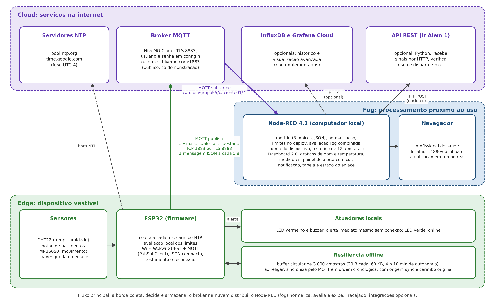
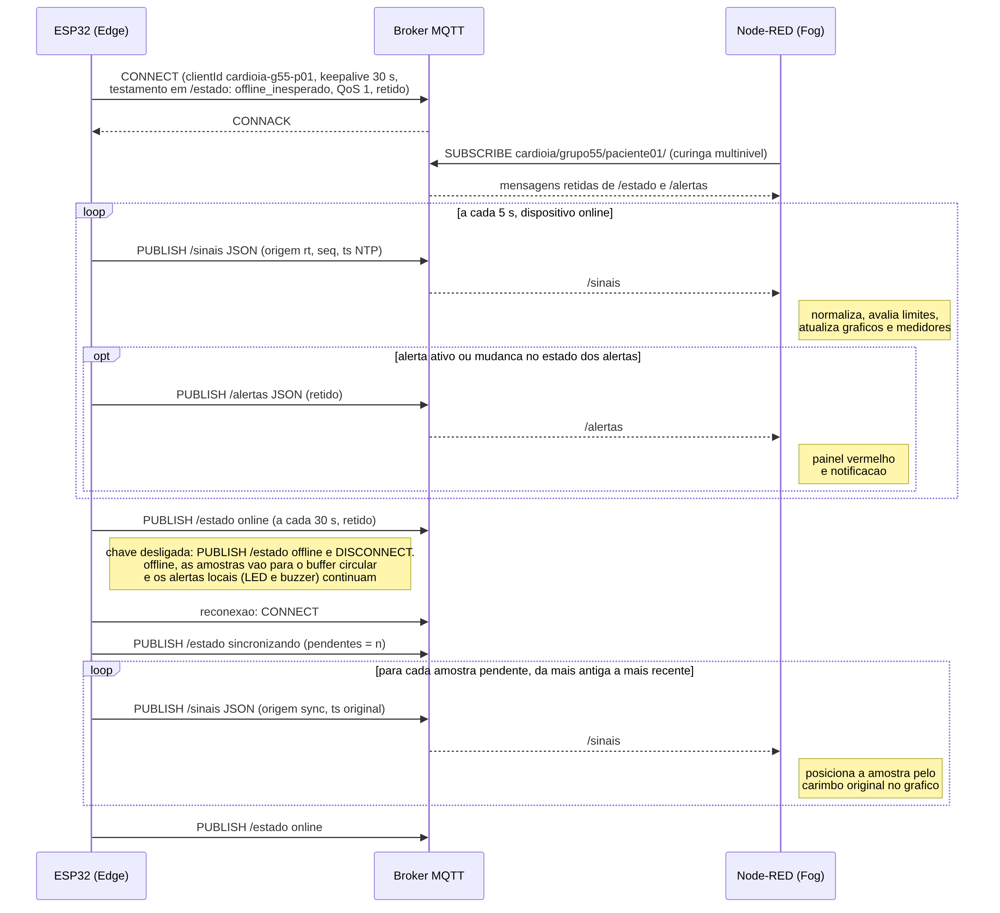
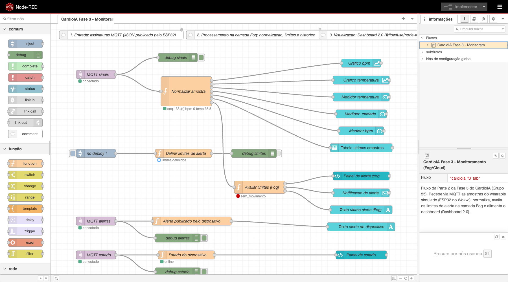
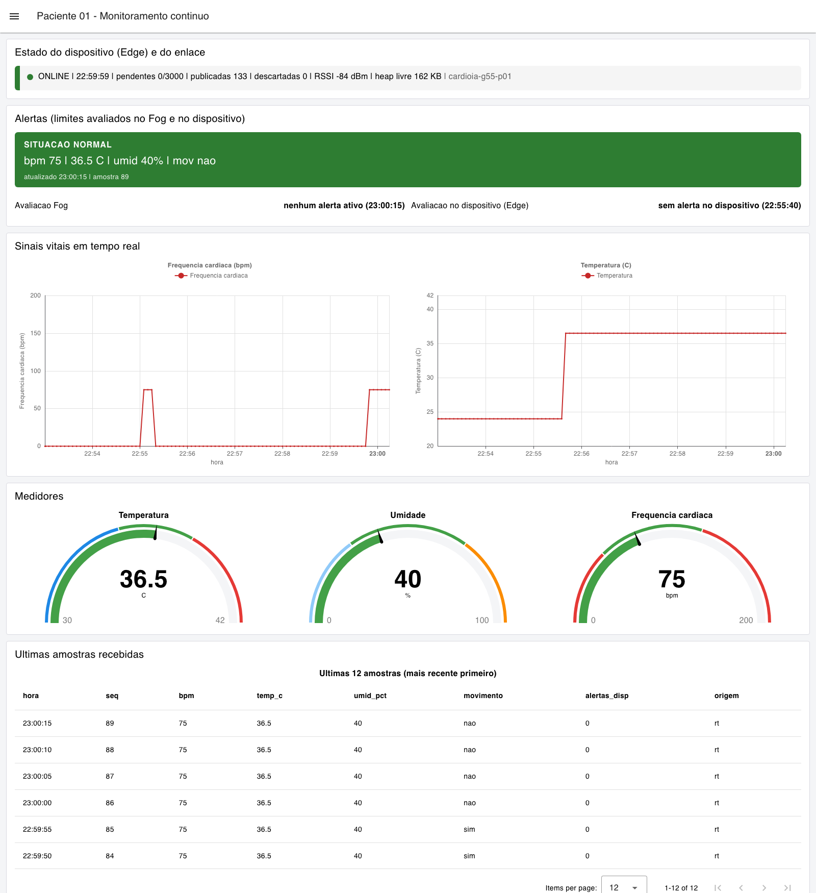
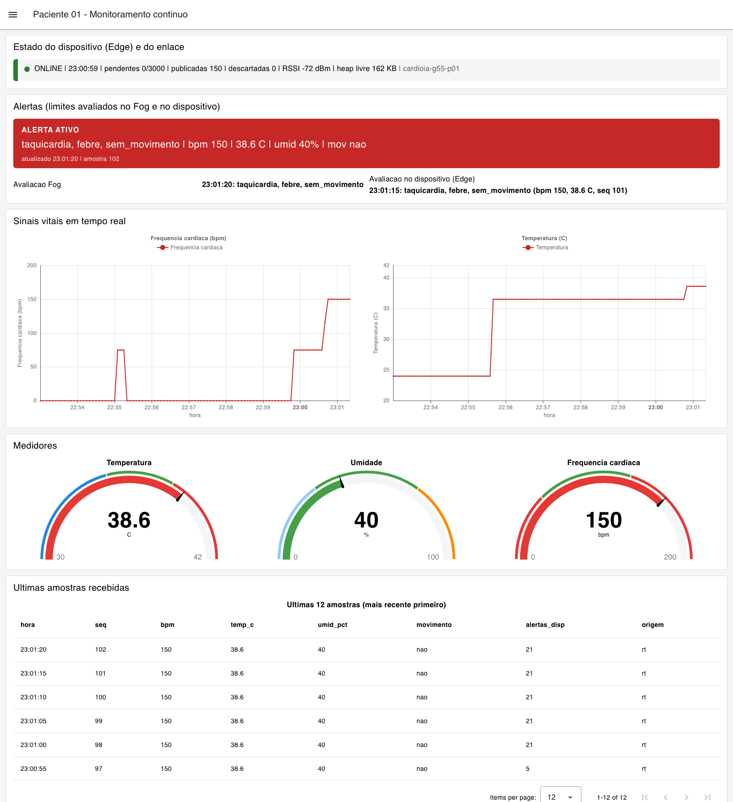
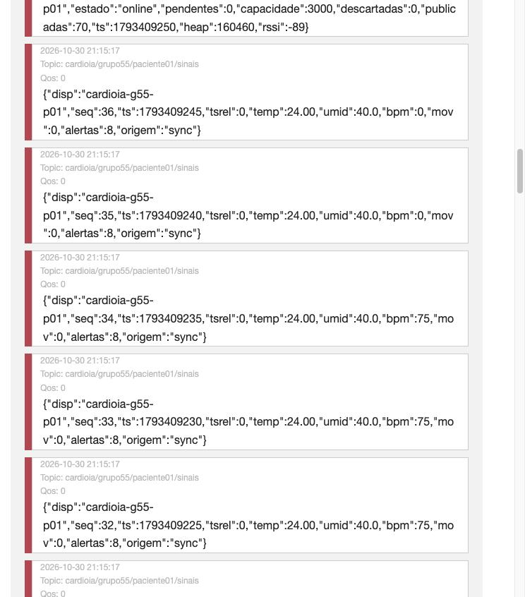
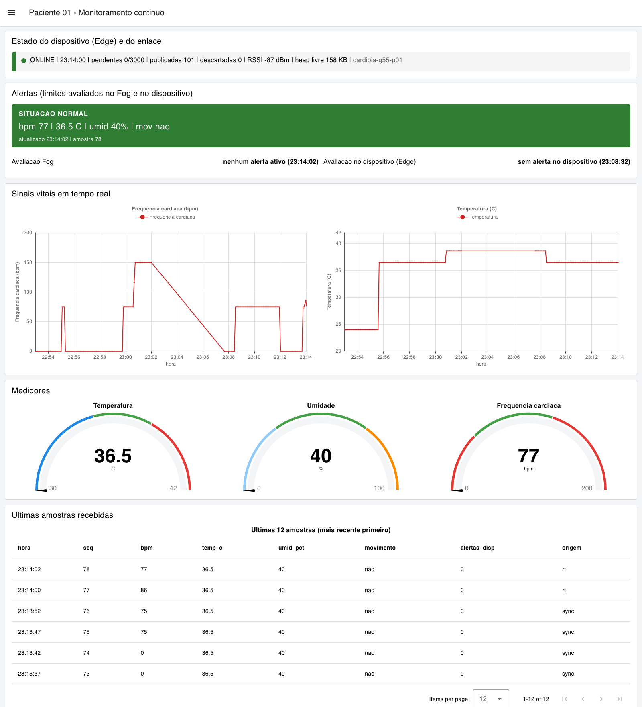
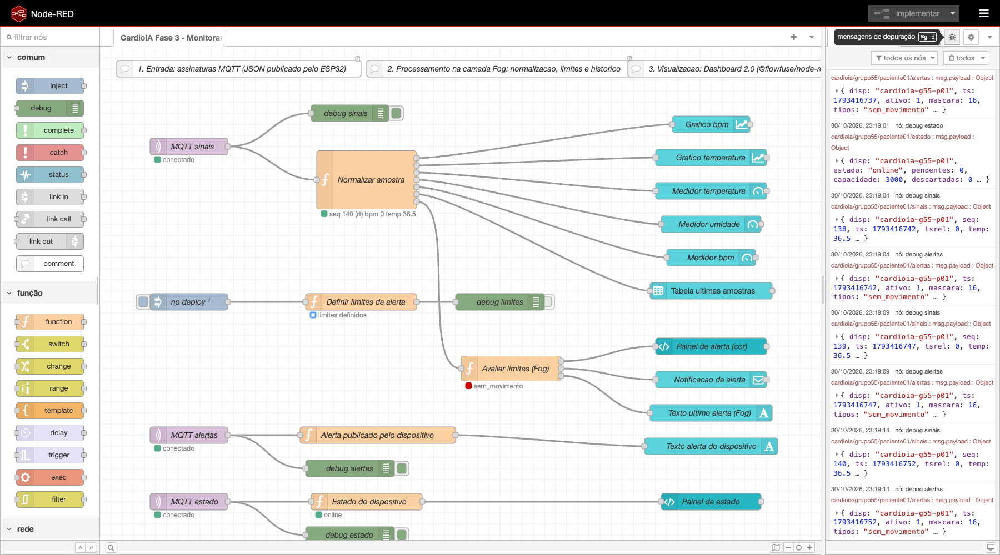

# CardioIA, Fase 3: Monitoramento Contínuo. Relatório da Parte 2: transmissão para a nuvem e visualização (Fog/Cloud Computing)


| Campo | Valor |
|---|---|
| Projeto | CardioIA, Ano 2, Fase 3 (Monitoramento Contínuo: IoT no Peito do Paciente) |
| Parte | 2, Transmissão para a nuvem e visualização (Fog/Cloud Computing) |
| Aluno | Silvio Prestes Guerreiro Junior, RM 567958 |
| Turma e grupo | 2TIAOR, Grupo 55 (formato individual) |
| Curso | Inteligência Artificial, FIAP |
| Tutor | Leonardo Ruiz Orabona |
| Coordenador | André Godoi Chiovato |
| Data | 31 de outubro de 2026 |
| Repositório | https://github.com/silvioguerreiro/FIAP_2TIAOR_2026_Ano2_Fase3 |
| Projeto no Wokwi | https://wokwi.com/projects/479362979389911041 |

## 1. Objetivo e arquitetura em três camadas

A Parte 2 completa o ciclo pedido pelo enunciado da Fase 3: captura, processamento, transmissão, visualização e alerta. O firmware da Parte 1 foi evoluído para publicar cada amostra em um broker MQTT pela rede Wi-Fi do simulador, e um fluxo no Node-RED recebe as mensagens, normaliza, avalia os limites de alerta e as exibe em um dashboard em tempo real com gráficos, medidores, indicador visual de alerta e notificação. O Grafana Cloud, opcional no enunciado, não foi implementado nesta entrega; a seção 7 indica como ele se encaixaria.

A Figura 1 apresenta a arquitetura. Na borda (Edge) está o ESP32 com os sensores, a avaliação local dos limites, os atuadores e o buffer de resiliência herdados da Parte 1. Na nuvem (Cloud) está o broker MQTT, que desacopla produtor e consumidores, além dos servidores NTP que fornecem o relógio. Na névoa (Fog) está o Node-RED, executado em um computador próximo do uso (o do profissional de saúde ou um gateway da clínica), que faz o processamento intermediário e serve o dashboard ao navegador. A divisão segue o capítulo 9 do curso, que descreve a névoa como a camada que conecta a borda à nuvem, atuando como ponto de processamento regional, filtragem de dados e integração com sistemas locais, e o capítulo 8, que atribui à nuvem o papel de intermediar a comunicação pelo broker e consolidar dados para visualização. Em um sistema real, o Node-RED também poderia ser hospedado na nuvem; o que o caracteriza como névoa aqui é a função (normalizar, avaliar e exibir perto de quem decide), não o endereço físico.



Figura 1. Arquitetura Edge, Fog e Cloud da solução. Linhas tracejadas indicam integrações opcionais não implementadas nesta entrega.

Uma decisão de projeto merece destaque: a avaliação dos limites acontece duas vezes, no dispositivo e no Node-RED. A avaliação na borda garante o alerta imediato ao paciente, com LED e buzzer, mesmo sem rede, que é o argumento de Edge Computing da Parte 1. A avaliação na névoa garante que o profissional veja o alerta ainda que o firmware tenha limites desatualizados, permite ajustar os limites sem regravar o dispositivo e combina as duas fontes: o fluxo soma aos seus próprios resultados os bits de alerta que o dispositivo publicou. O capítulo 9 descreve exatamente essa divisão ao afirmar que, nas arquiteturas híbridas, tarefas críticas são tratadas localmente enquanto o planejamento e a análise ficam nas camadas superiores.

## 2. Fluxo de comunicação MQTT

### 2.1 Broker, autenticação e criptografia

O broker previsto é o HiveMQ Cloud, no plano gratuito, com TLS na porta 8883 e autenticação por usuário e senha criados em Access Management, como mostra o capítulo 8 do curso. No projeto público do Wokwi, porém, qualquer credencial escrita no código ficaria visível a quem abrisse o link. Por isso o firmware seleciona o perfil de broker em tempo de compilação: se existir um arquivo config.h (mantido fora do versionamento pelo .gitignore e documentado por config.example.h), ele é usado com o HiveMQ Cloud, TLS e credenciais; se não existir, como no projeto público, o firmware usa o broker público de testes broker.hivemq.com na porta 1883, sem autenticação e sem criptografia, e registra essa condição no log. Toda a verificação desta entrega foi feita com o perfil público, o que é adequado para demonstração e inadequado para dados reais de pacientes: qualquer pessoa pode ler e publicar nos tópicos de um broker público. A seção 6 trata das implicações.

Com TLS habilitado, o firmware usa WiFiClientSecure. No simulador não há armazenamento de certificados raiz, e o código chama setInsecure(), que cifra a conexão mas não valida o certificado do servidor; isso protege contra escuta passiva, mas não contra um servidor impostor. Em produção, a linha correta, deixada comentada no código, é setCACert() com a cadeia da autoridade certificadora do broker (no HiveMQ Cloud, a raiz da autoridade emissora do certificado do cluster, atualmente a ISRG Root X1 da Let's Encrypt), o que fecha a validação da identidade do servidor, conforme a recomendação do capítulo 8 de usar certificados digitais e MQTT sobre TLS.

### 2.2 Cliente, sessão e testamento

O cliente MQTT é a biblioteca PubSubClient, padrão do curso, sobre o cliente Wi-Fi do ESP32 conectado à rede Wokwi-GUEST (canal 6, que acelera a associação no simulador). O identificador de cliente é único por dispositivo (cardioia-g55-p01), o keepalive é de 30 s e o tamanho do buffer de mensagens foi elevado para 512 bytes, porque o padrão de 256 não acomoda o JSON de estado com folga. Na conexão, o firmware registra um testamento (Last Will and Testament) no tópico de estado, com QoS 1 e retenção: se o dispositivo desaparecer sem se despedir, o broker publica por conta própria a mensagem {"estado":"offline_inesperado"}, e o dashboard passa a mostrar que o enlace caiu de forma anormal. Esse mecanismo foi exercitado involuntariamente durante a verificação: ao deixar a aba do simulador em segundo plano, a simulação pausou, o broker expirou a sessão e entregou o testamento ao assinante; o firmware reconectou sozinho em seguida (seção 5).

A reconexão é não bloqueante. A função atualizarRede roda a cada iteração do loop: enquanto a chave do diagrama estiver ligada, ela garante Wi-Fi, solicita o relógio por NTP (configTime com pool.ntp.org e time.google.com, fuso de Cuiabá, UTC-4) e tenta a conexão MQTT a cada 5 s em caso de falha, sem travar a coleta. Quando a chave é desligada, o firmware publica o estado "offline" antes de derrubar o enlace, desliga o rádio e passa a armazenar as amostras no buffer; a mesma rotina trata a perda real de Wi-Fi ou do broker. Um vigia de associação (vigiarAssociacaoWifi) completa a reconexão: se WiFi.begin não concluir em 30 s, o rádio é desligado e religado e a associação recomeça, com uma linha no log a cada tentativa, de modo que o dispositivo nunca fica preso em "conectando" depois de uma queda longa. A Figura 2 resume a sequência completa.



Figura 2. Sequência de mensagens MQTT entre o ESP32, o broker e o Node-RED, incluindo a queda do enlace e a sincronização do buffer.

### 2.3 Tópicos e payload

A hierarquia de tópicos separa a aplicação, o grupo, o paciente (pseudônimo) e o tipo de mensagem, o que permite controle de acesso por tópico no broker e assinaturas com curinga no Node-RED (cardioia/grupo55/paciente01/#). A Tabela 1 descreve os três tópicos; os payloads são JSON compactos gerados com snprintf, sem biblioteca de serialização, e os campos usam nomes curtos para reduzir o tráfego.

Tabela 1. Tópicos publicados pelo dispositivo.

| Tópico | Conteúdo | Frequência | Retido | Exemplo (tamanho) |
|---|---|---|---|---|
| cardioia/grupo55/paciente01/sinais | Uma amostra: disp, seq, ts (época Unix), tsrel (1 se o carimbo é relativo ao boot, sem NTP), temp, umid, bpm, mov, alertas (máscara de bits do dispositivo), origem ("rt" tempo real ou "sync" sincronização) | A cada 5 s online; em rajada na sincronização | Não | {"disp":"cardioia-g55-p01","seq":2,"ts":1793409075,"tsrel":0,"temp":24.00,"umid":40.0,"bpm":0,"mov":0,"alertas":8,"origem":"rt"} (128 bytes) |
| cardioia/grupo55/paciente01/alertas | Estado dos alertas avaliados no dispositivo: ativo, máscara, tipos por nome, bpm e temperatura da amostra | Quando a máscara muda e enquanto houver alerta ativo | Sim | {"disp":"cardioia-g55-p01","ts":1793409075,"ativo":1,"mascara":8,"tipos":"hipotermia","bpm":0,"temp":24.00,"seq":2} (115 bytes) |
| cardioia/grupo55/paciente01/estado | online, offline, sincronizando ou offline_inesperado (testamento), com pendentes, capacidade, descartadas, publicadas, heap e RSSI | Na mudança de estado e a cada 30 s (heartbeat) | Sim | {"disp":"cardioia-g55-p01","estado":"online","pendentes":0,"capacidade":3000,...,"rssi":-72} (149 bytes) |

Os campos seq e ts foram acrescentados em relação à Parte 1 (a amostra passou de 16 para 20 bytes) para que a camada Fog detecte lacunas na sequência e posicione corretamente, no eixo do tempo, as amostras que chegam atrasadas pela sincronização. A amostra coletada antes de o NTP sincronizar recebe tsrel=1 e o Node-RED usa a hora de chegada no lugar do carimbo; no log da verificação isso ocorreu apenas com a primeira amostra.

### 2.4 Qualidade de serviço e confiabilidade

A PubSubClient publica apenas com QoS 0 (entrega no máximo uma vez); o QoS 1 está disponível somente para assinaturas e para o testamento. Como a especificação do enunciado pede confiabilidade nos alertas, a solução adota quatro mecanismos complementares que, juntos, cobrem os casos que o QoS 1 cobriria: a mensagem de alerta é retida, de modo que um dashboard que se conecte depois do evento recebe imediatamente o último estado de alerta; todas as amostras carregam um número de sequência, o que permite ao Fog detectar perdas e registrá-las; o testamento com QoS 1 garante que a queda anormal do dispositivo seja sempre comunicada; e, na sincronização, cada amostra só é removida do buffer depois de mqtt.publish retornar sucesso, de forma que uma queda no meio da rajada deixa o restante pendente para a próxima conexão. A troca pela biblioteca MQTT de Joël Gaehwiler (arduino-mqtt), que publica com QoS 1 e 2, foi avaliada e registrada como alternativa direta caso a confirmação de entrega por mensagem seja exigida.

A sincronização via MQTT respeita o broker e a rede: as amostras pendentes saem em ordem cronológica com uma pausa de 20 ms entre publicações e uma chamada a mqtt.loop() a cada envio, para manter o keepalive. Na verificação, nove amostras pendentes foram publicadas em menos de um segundo após a reconexão (seção 5). Com o buffer cheio de 3.000 amostras, a rajada levaria cerca de 60 s, o que é aceitável para um reenvio de quatro horas de dados.

## 3. Configuração do Node-RED e do dashboard

### 3.1 Ambiente

O fluxo foi construído com Node-RED 4.1.17 e o Dashboard 2.0 (@flowfuse/node-red-dashboard 1.34.1), primeiro no ambiente de trabalho (Node.js 22, broker local e simulador de mensagens) e depois no computador do aluno (macOS, Node.js 24.16), onde foi executado de ponta a ponta com o ESP32 do Wokwi publicando no broker público; as capturas deste relatório vêm dessa execução (seção 4.2). O Dashboard 2.0 foi escolhido no lugar do node-red-dashboard original porque este último está em modo de manutenção, depende do AngularJS descontinuado e não é mais recomendado pela comunidade, enquanto o Dashboard 2.0 é o sucessor oficial mantido pela FlowFuse. A instalação é reproduzível em três comandos (npm install -g node-red; npm install @flowfuse/node-red-dashboard na pasta ~/.node-red; node-red), documentados em src/parte2_fog_cloud/node_red/README.md junto com a lista de versões (pacotes.txt). O export completo dos fluxos está em flows.json; o arquivo é gerado por um script Python (scripts/gerar_flows_node_red.py) que mantém identificadores estáveis e serve de documentação do fluxo.

### 3.2 Estrutura do fluxo

O fluxo tem 37 nós organizados em três grupos, com comentários no próprio editor (Tabela 2). A Figura 3 mostra o editor com o fluxo importado.

Tabela 2. Nós do fluxo e sua função.

| Grupo | Nós | Função |
|---|---|---|
| 1. Entrada | MQTT sinais, MQTT alertas, MQTT estado (mqtt in com saída em JSON), debug de cada tópico, nó de configuração Broker MQTT | Assinam os três tópicos no broker; a conversão de JSON é feita pelo próprio nó mqtt in (datatype json); os nós debug alimentam o painel de depuração |
| 2. Processamento (Fog) | inject "no deploy", Definir limites de alerta, Normalizar amostra, Avaliar limites (Fog), Estado do dispositivo, Alerta publicado pelo dispositivo | Definem os limites no contexto do fluxo ao fazer deploy; normalizam a amostra (tipos numéricos, carimbo em milissegundos, histórico das 12 últimas); avaliam os limites e combinam com a máscara do dispositivo; traduzem o estado do enlace e o alerta retido |
| 3. Visualização (Dashboard 2.0) | ui-chart Gráfico bpm e Gráfico temperatura; ui-gauge Medidor temperatura, Medidor umidade, Medidor bpm; ui-template Painel de alerta (cor) e Painel de estado; ui-notification; ui-text com a última avaliação Fog e com o alerta do dispositivo; ui-table com as últimas 12 amostras; nós de configuração ui-base, ui-page, cinco ui-group e ui-theme | Página "Paciente 01 - Monitoramento continuo" com cinco grupos: estado do dispositivo e do enlace, alertas, sinais vitais em tempo real, medidores e últimas amostras |



Figura 3. Editor do Node-RED no computador do aluno com o fluxo importado e em execução: os três nós mqtt in marcados como conectados ao broker público, o estado da última amostra normalizada (seq 133, 36,5 C) sob a função de normalização e o estado "online" sob a função de estado do dispositivo.

A função Normalizar amostra converte os campos para números, decide o carimbo de tempo (ts do dispositivo em milissegundos quando NTP estava sincronizado; hora de chegada quando tsrel=1), guarda a última amostra e um histórico de 12 linhas no contexto do fluxo e distribui sete mensagens: duas para os gráficos (com msg.timestamp), três para os medidores, uma para a tabela e uma para a avaliação. Os gráficos usam o eixo X do tipo tempo alimentado por msg.timestamp em vez da hora de chegada; por isso, quando o dispositivo sincroniza o buffer após uma queda, as amostras atrasadas aparecem no lugar correto da linha do tempo, e não empilhadas no instante da reconexão. A janela dos gráficos é de 60 minutos.

### 3.3 Regras de alerta e limites

A função Definir limites de alerta é executada no deploy e grava no contexto do fluxo os limites da Tabela 3, que são os mesmos do firmware, exceto a ausência de movimento, mantida em 600 s no Fog (valor de produção) enquanto o dispositivo usa 60 s no modo de demonstração; como o Fog também aceita o bit de ausência de movimento vindo do dispositivo, o alerta aparece no dashboard nos dois casos.

Tabela 3. Limites de alerta e justificativa.

| Regra | Limite | Justificativa |
|---|---|---|
| Taquicardia | bpm acima de 120 | Valor sugerido pelo enunciado; acima de 100 bpm em repouso já é taquicardia pela definição clínica usual, mas 120 reduz falsos alertas por esforço leve ou pela imprecisão do botão como sensor |
| Bradicardia | bpm abaixo de 50, com bpm maior que zero | Faixa usual para bradicardia sintomática em adultos (abaixo de 50 a 60 bpm); bpm igual a zero significa ausência de leitura, não parada, e não gera alerta |
| Febre | temperatura acima de 38,0 C | Valor sugerido pelo enunciado e limiar clínico consagrado para febre |
| Hipotermia | temperatura abaixo de 35,0 C | Definição clínica de hipotermia (temperatura central abaixo de 35 C); no simulador, o DHT22 inicia em 24 C e o alerta serve para demonstrar o mecanismo |
| Ausência de movimento | mais de 600 s sem movimento (60 s na demonstração do dispositivo) | Paciente cardíaco imóvel por 10 minutos pode ter sofrido queda ou síncope; o intervalo evita alertas durante repouso breve |

A função Avaliar limites (Fog) aplica as regras, acrescenta os tipos indicados pela máscara do dispositivo e produz três saídas: o painel de alerta (ui-template em Vue) que muda de verde para vermelho e lista os tipos, a hora e a amostra; a notificação (ui-notification), disparada apenas quando surge um tipo novo de alerta em tempo real, para não repetir a cada 5 s nem durante a sincronização de dados antigos; e o texto da última avaliação. A função Alerta publicado pelo dispositivo trata a mensagem retida do tópico de alertas e a exibe em um segundo texto, o que torna visível para o avaliador a diferença entre a decisão tomada na borda e a tomada na névoa. A função Estado do dispositivo traduz o tópico de estado para o painel de estado, que mostra ONLINE, OFFLINE, SINCRONIZANDO ou OFFLINE INESPERADO (testamento), com pendentes, publicadas, descartadas, RSSI e heap livre. As Figuras 4 e 5 mostram o dashboard em estado normal e com alerta ativo.



Figura 4. Dashboard em estado normal com dados do ESP32 no Wokwi (30/10/2026, 23h00): dispositivo ONLINE com 133 publicações e nenhuma pendente, painel verde com 75 bpm e 36,5 C, gráficos com a mudança do DHT22 de 24 para 36,5 C e o início dos batimentos pelo botão, medidores e tabela das últimas amostras, duas delas com movimento detectado pelo MPU6050.



Figura 5. Dashboard com alerta ativo (23h01): o botão pressionado a cada 400 ms (150 bpm) e o DHT22 em 38,6 C produziram taquicardia e febre, e 60 s após o último movimento o dispositivo acrescentou a ausência de movimento (máscara 21); o painel fica vermelho, as avaliações Fog e Edge coincidem e os medidores entram nas faixas de alerta.

## 4. Evidências da comunicação MQTT

### 4.1 Verificação com assinante independente no broker

O firmware da Parte 2 foi compilado e executado no Wokwi em 30 de outubro de 2026, conectado ao broker público. Para verificar as publicações do lado do broker, um assinante independente, o HiveMQ Websocket Client, foi conectado ao mesmo broker com a assinatura cardioia/grupo55/#. O log completo do monitor serial está em assets/evidencias/parte2/log_serial_parte2_wokwi_2026-10-30.txt e o do assinante em log_broker_websocket_client_2026-10-30.txt, com as capturas p2_01 a p2_03. O trecho a seguir, do monitor serial, cobre a conexão, a queda provocada pela chave e a sincronização.

```
[BOOT] CardioIA Fase 3, Parte 2 (Fog/Cloud): wearable cardiaco com MQTT
[BOOT] amostragem=5000 ms, buffer=3000 amostras x 20 bytes = 60000 bytes
[BOOT] topicos: cardioia/grupo55/paciente01/sinais | cardioia/grupo55/paciente01/alertas | cardioia/grupo55/paciente01/estado
[WIFI] conectando a "Wokwi-GUEST" (canal 6)...
[OFFLINE] seq=1 ts=4 temp=24.00 umid=40.0 bpm=0 mov=0 alertas=8 | armazenada (1/3000)
[WIFI] conectado, IP 10.10.0.2, RSSI -82 dBm; NTP solicitado
[MQTT] conectando a broker.hivemq.com:1883 (TLS=0) como cardioia-g55-p01...
[ONLINE] conectado ao broker em t=5 s; 1 amostras pendentes
[SYNC] concluida: 1 de 1 enviadas; pendentes=0 (total sincronizadas=1)
[NTP] relogio sincronizado: 1793409072 (epoca Unix)
[ONLINE] cardioia/grupo55/paciente01/sinais <- {"disp":"cardioia-g55-p01","seq":2,"ts":1793409075,"tsrel":0,"temp":24.00,"umid":40.0,"bpm":0,"mov":0,"alertas":8,"origem":"rt"}
[MQTT] cardioia/grupo55/paciente01/alertas <- {"disp":"cardioia-g55-p01","ts":1793409075,"ativo":1,"mascara":8,"tipos":"hipotermia","bpm":0,"temp":24.00,"seq":2}
[OFFLINE] conexao MQTT perdida; armazenando localmente
[ONLINE] conectado ao broker em t=51 s; 0 amostras pendentes
[MQTT] cardioia/grupo55/paciente01/estado <- {"disp":"cardioia-g55-p01","estado":"offline","pendentes":0,"capacidade":3000,"descartadas":0,"publicadas":59,"ts":1793409201,"heap":165608,"rssi":-88}
[OFFLINE] enlace desligado pela chave em t=135 s; armazenando localmente
[OFFLINE] seq=28 ts=1793409205 temp=24.00 umid=40.0 bpm=0 mov=0 alertas=8 | armazenada (1/3000)
[OFFLINE] seq=31 ts=1793409220 temp=24.00 umid=40.0 bpm=75 mov=0 alertas=8 | armazenada (4/3000)
[OFFLINE] seq=36 ts=1793409245 temp=24.00 umid=40.0 bpm=0 mov=0 alertas=8 | armazenada (9/3000)
[ONLINE] conectado ao broker em t=183 s; 9 amostras pendentes
[SYNC] iniciando sincronizacao de 9 amostras pendentes via MQTT
[SYNC] concluida: 9 de 9 enviadas; pendentes=0 (total sincronizadas=10)
[MQTT] cardioia/grupo55/paciente01/estado <- {"disp":"cardioia-g55-p01","estado":"online","pendentes":0,"capacidade":3000,"descartadas":0,"publicadas":70,"ts":1793409250,"heap":160460,"rssi":-89}
```

Do lado do broker, o assinante registrou os mesmos eventos: ao assinar, recebeu imediatamente as duas mensagens retidas (último estado e último alerta); às 21h12 recebeu o testamento "offline_inesperado" com QoS 1 quando a sessão do dispositivo expirou com a aba do simulador em segundo plano, seguido da reconexão automática; recebeu as amostras em tempo real a cada 5 s; às 21h14 recebeu o estado "offline" publicado antes da queda do enlace; e às 21h15 recebeu o estado "sincronizando" com pendentes=9 e, em seguida, as nove amostras seq 28 a 36 com origem "sync" e os carimbos de tempo originais (1793409205 a 1793409245), em ordem cronológica, antes de o tempo real recomeçar em seq 37 (Figura 6).



Figura 6. HiveMQ Websocket Client assinando cardioia/grupo55/# no broker público: amostras com origem "sync" e carimbos originais chegando após a reconexão do ESP32.

### 4.2 Execução de ponta a ponta com o Node-RED no computador do aluno

Na noite de 30 de outubro o Node-RED foi instalado no computador do aluno (pasta ~/cardioia-nodered, Node-RED 4.1.17 e Dashboard 2.0 1.34.1 sobre Node.js 24.16; log em assets/evidencias/parte2/log_node_red_mac_2026-10-30.txt), o fluxo flows.json foi importado sem alterações e o cliente MQTT do Node-RED conectou-se ao broker público (identificador cardioia-nodered-g55). Com o projeto da Parte 2 em execução no Wokwi, o caminho completo ficou ativo: ESP32, broker, Node-RED, dashboard. O roteiro de demonstração cobriu os quatro estados. Primeiro, com o DHT22 em 36,5 C e o botão a 800 ms, o dashboard mostrou a situação normal (Figura 4). Em seguida, o botão a 400 ms e o DHT22 em 38,6 C levaram a taquicardia e febre, e o dispositivo acrescentou a ausência de movimento após 60 s sem variação no MPU6050 (Figura 5). Depois, a chave foi desligada: o firmware publicou o estado "offline" antes de derrubar o enlace, o painel de estado passou a OFFLINE e os gráficos pararam de avançar, enquanto o monitor serial mostrava o dispositivo coletando, avaliando os alertas localmente e armazenando as amostras (captura p2_12_dashboard_offline_esp32.png). Por fim, a chave foi religada após 75 s: o firmware reconectou, publicou o estado "sincronizando" com pendentes=15, enviou as quinze amostras pendentes em ordem cronológica e publicou "online" com publicadas=101. A Figura 7 mostra o dashboard logo após essa sincronização, com as linhas de origem "sync" na tabela, carimbos de tempo originais entre 23h12m42s e 23h13m52s e o gráfico preenchido sem lacuna, e a Figura 8 mostra o painel de depuração do editor recebendo as mensagens dos três tópicos. O log do monitor serial dessa sessão está em log_serial_parte2_wokwi_2026-10-30_nodered_mac.txt; o trecho a seguir mostra a segunda queda e a sincronização.

```
[MQTT] cardioia/grupo55/paciente01/estado <- {"disp":"cardioia-g55-p01","estado":"offline","pendentes":0,"capacidade":3000,"descartadas":0,"publicadas":84,"ts":1793416361,"heap":165620,"rssi":-78}
[OFFLINE] enlace desligado pela chave em t=307 s; armazenando localmente
[OFFLINE] seq=62 ts=1793416362 temp=36.50 umid=40.0 bpm=0 mov=0 alertas=0 | armazenada (1/3000)
[OFFLINE] seq=63 ts=1793416367 temp=36.50 umid=40.0 bpm=0 mov=1 alertas=0 | armazenada (2/3000)
[OFFLINE] seq=76 ts=1793416432 temp=36.50 umid=40.0 bpm=75 mov=0 alertas=0 | armazenada (15/3000)
[WIFI] conectando a "Wokwi-GUEST" (canal 6)...
[MQTT] conectando a broker.hivemq.com:1883 (TLS=0) como cardioia-g55-p01...
[ONLINE] conectado ao broker em t=385 s; 15 amostras pendentes
[SYNC] iniciando sincronizacao de 15 amostras pendentes via MQTT
[MQTT] cardioia/grupo55/paciente01/estado <- {"disp":"cardioia-g55-p01","estado":"sincronizando","pendentes":15,"capacidade":3000,"descartadas":0,"publicadas":85,"ts":1793416439,"heap":165564,"rssi":-84}
[SYNC] 10/15 enviadas (seq 71)
[SYNC] concluida: 15 de 15 enviadas; pendentes=0 (total sincronizadas=30)
[MQTT] cardioia/grupo55/paciente01/estado <- {"disp":"cardioia-g55-p01","estado":"online","pendentes":0,"capacidade":3000,"descartadas":0,"publicadas":101,"ts":1793416440,"heap":162164,"rssi":-87}
```



Figura 7. Dashboard logo após a reconexão (23h14): estado ONLINE com publicadas=101 e nenhuma pendente, situação normal e tabela com as amostras de origem "sync" (seq 73 a 76, com os carimbos de tempo do período offline) seguidas das amostras em tempo real.



Figura 8. Painel de depuração do editor no computador do aluno recebendo as mensagens do ESP32 nos três tópicos: amostras (seq 138 a 140), alerta retido com máscara 16 (ausência de movimento) e estado "online".

Transparência sobre o que foi e o que não foi verificado: a publicação MQTT, a sincronização do buffer pela nuvem, o testamento e as mensagens retidas foram verificados com o dispositivo no Wokwi e um assinante independente (seção 4.1), e o fluxo do Node-RED foi executado com o dispositivo real no computador do aluno (seção 4.2); o simulador de mensagens (scripts/simulador_mqtt_esp32.js) e o broker local serviram apenas à construção do fluxo no ambiente de trabalho. Uma limitação do simulador foi observada: após cerca de 5 minutos com a chave desligada e o rádio Wi-Fi desativado, o Wokwi não restabeleceu a associação à rede Wokwi-GUEST, mesmo com novas alternâncias da chave; o dispositivo seguiu coletando e armazenando (62 amostras na RAM, com os alertas locais ativos), mas a sincronização só pôde ser demonstrada reiniciando a simulação e repetindo a queda com durações de 65 s e 75 s, que sincronizaram 14 e 15 amostras. Em resposta, o firmware ganhou o vigia de associação descrito na seção 2.2; em novo teste no mesmo dia (23h35 a 23h43, apêndice do log), após 5 min 21 s com o rádio desligado o vigia registrou quatro tentativas de reassociação em 2 min, todas sem resposta do simulador, enquanto a coleta e o armazenamento seguiram normais (93 amostras pendentes). O comportamento é, portanto, do ambiente simulado; em um chip real a reassociação é tratada pelo controlador Wi-Fi e, como último recurso, por um reinício supervisionado do dispositivo, que não perde dados quando a camada SPIFFS está ativa. O perfil HiveMQ Cloud com TLS e credenciais está pronto no código e em config.example.h, mas não foi executado nesta entrega.

## 5. Eficiência, segurança e boas práticas em IoT médico

Dados de saúde são dados pessoais sensíveis pela Lei Geral de Proteção de Dados (art. 5º, II, da Lei nº 13.709/2018), cujo tratamento exige base legal específica (art. 11) e medidas de segurança aptas a proteger os dados de acessos não autorizados (art. 46). O capítulo 7 do curso (Governança Inteligente) traduz esses requisitos em práticas de compliance by design: minimização de dados, limitação de propósito, pseudonimização, controle de acesso e trilhas de auditoria desde o projeto. As decisões a seguir aplicam essas práticas ao protótipo e indicam o que muda em produção.

Minimização e pseudonimização. O payload contém apenas o necessário para o monitoramento: carimbo de tempo, quatro grandezas fisiológicas e ambientais, a máscara de alertas e metadados técnicos. Nenhum nome, documento, data de nascimento ou localização trafega. O paciente é identificado por um pseudônimo (paciente01, dispositivo cardioia-g55-p01) e a correspondência com a pessoa real ficaria em um cadastro separado e protegido, na plataforma do CardioIA, nunca no dispositivo nem no broker. O histórico mantido no Node-RED é curto (12 amostras na tabela, 60 minutos nos gráficos) e não há armazenamento persistente de séries nesta entrega; a retenção de longo prazo, quando existir, deve ter política explícita de descarte, como recomenda o capítulo 7.

Credenciais fora do código e controle de acesso por tópico. As credenciais do broker ficam em config.h, excluído do versionamento, com config.example.h versionado como modelo; o projeto público do Wokwi não contém segredos. No Node-RED, usuário e senha do broker ficam no arquivo de credenciais criptografado e não entram no flows.json exportado. Em produção, o HiveMQ Cloud permite criar um usuário por dispositivo com permissão de publicação restrita ao seu prefixo (cardioia/grupo55/paciente01/#) e um usuário de leitura para o Node-RED, de modo que um dispositivo comprometido não consiga publicar em nome de outro paciente nem ler os dados dos demais.

Criptografia em trânsito. O perfil de produção usa MQTT sobre TLS na porta 8883, com validação do certificado do servidor por setCACert; o setInsecure() do simulador é uma concessão documentada, e o broker público sem TLS é apenas para demonstração. As mensagens retidas merecem atenção especial: por conterem o último valor de sinais vitais, elas ficam armazenadas no broker até serem substituídas, o que reforça a necessidade de autenticação e de controle de acesso por tópico.

Disponibilidade e integridade. O testamento informa quedas anormais; o número de sequência permite detectar lacunas; o buffer com remoção apenas após publicação bem-sucedida evita perda silenciosa; o contador de descartes torna visível qualquer perda por saturação. Esses mecanismos compensam a ausência de QoS 1 na publicação, como discutido na seção 2.4.

Intervalo de amostragem, tráfego e energia. Uma amostra a cada 5 s gera 17.280 mensagens de sinais por dia, cerca de 128 bytes cada, ou aproximadamente 2,2 MB por dia por paciente antes da sobrecarga de protocolo, volume baixo para Wi-Fi ou celular e para o plano gratuito do broker. O envio de alertas apenas quando a máscara muda ou enquanto há alerta ativo, e do estado a cada 30 s, segue a recomendação do capítulo 9 de transmitir eventos relevantes em vez de dados brutos contínuos. Em um wearable a bateria, o rádio Wi-Fi é o maior consumidor de energia; as evoluções naturais são agrupar várias amostras por publicação, dormir entre amostras (light sleep do ESP32) e publicar o detalhe apenas quando houver alerta, mantendo na borda a média de período. O intervalo de 5 s foi mantido nesta entrega porque o objetivo é demonstrar o monitoramento contínuo com resolução suficiente para alertas de frequência cardíaca.

Limites de taxa e robustez do servidor. A sincronização do buffer é espaçada (20 ms entre publicações) para não inundar o broker; em produção, um limite de taxa por dispositivo no broker e a validação do esquema das mensagens no Node-RED (a função de normalização rejeita payloads não JSON e registra um aviso) protegem o dashboard de dados malformados.

Responsabilidade clínica. O dashboard sinaliza e prioriza; a decisão é do profissional de saúde. Os limites são parametrizáveis e documentados, a avaliação do dispositivo e a da névoa são exibidas separadamente, e todas as mensagens têm carimbo de tempo e sequência, o que fornece a trilha de auditoria defendida pelo capítulo 7. Nenhum artefato desta entrega é dispositivo médico; os dados são simulados.

## 6. Conclusão e ligação com as próximas fases

A Parte 2 fechou o ciclo captura, processamento, transmissão, visualização e alerta exigido pela Fase 3. O ESP32 publica as amostras e os alertas em um broker MQTT com tópicos hierárquicos, payload compacto, testamento e reconexão automática, e sincroniza pela nuvem, em ordem cronológica, tudo o que acumulou enquanto esteve offline, como comprovaram o monitor serial e um assinante independente. O Node-RED recebe, normaliza, reavalia os limites e exibe os sinais em um dashboard com gráficos no tempo real das amostras, medidores, painel de alerta com cor e notificação. A reflexão sobre segurança mostrou que o protótipo já incorpora minimização, pseudonimização, credenciais fora do código e preparação para TLS, e deixou explícito o que separa a demonstração em broker público de um sistema apto a tratar dados reais de pacientes.

No CardioIA, esta fase entrega a fonte de dados objetivos que faltava. A série temporal publicada em .../sinais, com carimbo de tempo, sequência e rótulo de alerta por amostra, é o insumo direto da Fase 6 (Coração Sob Controle), que trabalhará com previsão de crises a partir de séries temporais; os alertas podem alimentar o assistente da Fase 5 e a plataforma integrada da Fase 7; e a triagem textual da Fase 2 ganha, com estes sinais, a dimensão objetiva que lhe faltava. As extensões imediatas são a gravação do histórico em InfluxDB Cloud com visualização no Grafana Cloud, a partir do mesmo fluxo do Node-RED, e a API REST com automação de e-mail proposta no Ir Além 1, que o fluxo já está preparado para chamar.

## Referências

BRASIL. Lei nº 13.709, de 14 de agosto de 2018. Lei Geral de Proteção de Dados Pessoais (LGPD). Diário Oficial da União: seção 1, Brasília, DF, 15 ago. 2018.

ESPRESSIF SYSTEMS. Arduino core for the ESP32: WiFiClientSecure. Disponível em: https://github.com/espressif/arduino-esp32/tree/master/libraries/NetworkClientSecure. Acesso em: 30 out. 2026.

FIAP. CardioIA Conectada: IoT e Visualização de Dados para a Saúde Digital. Capítulo 1 do material didático da Fase 3, 2º ano, curso de Inteligência Artificial. São Paulo: FIAP, 2025.

FIAP. Governança Inteligente: Frameworks e Arquiteturas de Dados na Era da IA. Capítulo 7 do material didático da Fase 3, 2º ano, curso de Inteligência Artificial. São Paulo: FIAP, 2025.

FIAP. Cloud Computing como Pilar da IoT Moderna. Capítulo 8 do material didático da Fase 3, 2º ano, curso de Inteligência Artificial. São Paulo: FIAP, 2025.

FIAP. Inteligência na Borda: Fog e Edge Computing Transformando a IoT. Capítulo 9 do material didático da Fase 3, 2º ano, curso de Inteligência Artificial. São Paulo: FIAP, 2025.

FLOWFUSE. Node-RED Dashboard 2.0 documentation. Disponível em: https://dashboard.flowfuse.com/. Acesso em: 30 out. 2026.

HIVEMQ. HiveMQ Cloud documentation: Getting started, Access Management, TLS. Disponível em: https://docs.hivemq.com/hivemq-cloud/. Acesso em: 30 out. 2026.

HIVEMQ. MQTT Essentials. Disponível em: https://www.hivemq.com/mqtt/mqtt-essentials/. Acesso em: 30 out. 2026.

O'LEARY, N. Arduino Client for MQTT (PubSubClient): API documentation. Disponível em: https://pubsubclient.knolleary.net/api. Acesso em: 30 out. 2026.

OASIS. MQTT Version 3.1.1. OASIS Standard, 29 out. 2014. Disponível em: http://docs.oasis-open.org/mqtt/mqtt/v3.1.1/os/mqtt-v3.1.1-os.html. Acesso em: 30 out. 2026.

OPENJS FOUNDATION. Node-RED documentation. Disponível em: https://nodered.org/docs/. Acesso em: 30 out. 2026.

WOKWI. Wokwi Documentation: ESP32 WiFi, MQTT. Disponível em: https://docs.wokwi.com/guides/esp32-wifi. Acesso em: 30 out. 2026.
